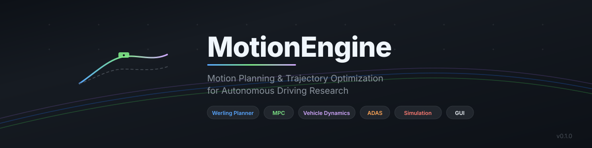

<div align="center">

<picture>
  <source media="(prefers-color-scheme: dark)" srcset="docs/images/banner.svg">
  <source media="(prefers-color-scheme: light)" srcset="docs/images/banner.svg">
  
</picture>

<br/>

**Open-source framework for motion planning, trajectory optimization, vehicle dynamics simulation, and autonomous driving research.**

[](https://github.com/alivsch-ai-code/MotionEngine/actions/workflows/ci.yml)
[](https://www.python.org/downloads/)
[](LICENSE)
[](https://docs.astral.sh/ruff/)

[Getting Started](#-quick-start) · [Architecture](#-architecture) · [Documentation](docs/) · [Examples](examples/) · [Contributing](CONTRIBUTING.md)

</div>

---

## Highlights

- **Trajectory Planning** — Werling (Frenet frame) planner with quintic polynomial sampling, jerk-optimal cost functions, and real-time collision avoidance
- **Vehicle Dynamics** — Five fidelity levels from 4-state kinematic to 24-DOF multibody, three tire models including Pacejka Magic Formula
- **Motion Control** — Stanley, Pure Pursuit, MPC; ACC, AEB, lane keeping; ABS, TCS, ESP, torque vectoring, active suspension
- **Production Patterns** — Plugin registry, layered architecture, 22 pre-built ISO/ADAS scenarios, automated KPI evaluation
- **Desktop GUI** — PySide6 application with live top view, signal scope, 3D visualization, analysis plots, trajectory editor

---

## Architecture

<div align="center">

</div>

MotionEngine follows a layered architecture where dependencies point strictly downward. The simulation core accesses all components through abstract interfaces (`vdsim.core.interfaces`) and a plugin registry — adding a new vehicle model, tire model, controller, or maneuver requires **zero changes** to the core.

See [docs/ARCHITECTURE.md](docs/ARCHITECTURE.md) for the full architecture documentation including data flow diagrams, UML class/sequence diagrams, and the extension API.

---

## Trajectory Planning

The planning module implements the Werling optimal trajectory generation approach in curvilinear (Frenet) coordinates.

<div align="center">

</div>

<div align="center">

</div>

**Pipeline stages:**

| Stage | Method | Reference |
|---|---|---|
| Lateral sampling | Quintic polynomials in Frenet d-coordinate | Werling (2011), eq. 3.6–3.8 |
| Longitudinal sampling | Quartic/quintic polynomials for velocity/position | Werling (2011), eq. 3.9–3.12 |
| Combination | Frenet → Cartesian via reference line projection | Werling (2011), Appendix A |
| Constraint checking | Curvature, acceleration, jerk, steering, stability | Configurable bounds |
| Collision detection | Circle-covering method | Ziegler & Stiller (2010) |
| Cost evaluation | Weighted jerk + deviation + time + comfort + energy | Werling (2011), eq. 3.13 |
| Trajectory stitching | Smooth continuation from previous planning cycle | |

---

## Vehicle Dynamics

<div align="center">

</div>

Five fidelity levels, all validated against analytical solutions:

| Model | States | Capabilities |
|---|---|---|
| **Kinematic bicycle** | 4 | Ackermann geometry, rear-axle steering, path planning |
| **Linear bicycle** | 6 | State-space form, frequency response, stability analysis |
| **Nonlinear bicycle** | 6 | Tire model coupling, friction ellipse, load transfer |
| **Double-track** | 12 | Roll dynamics, wheel spin, per-wheel friction, ESP/ABS |
| **Multibody** | 24 | Heave/roll/pitch, unsprung masses, road excitation, ISO 2631 |

**Tire models:** Linear (with friction circle), Pacejka Magic Formula (load-dependent, combined slip, camber), Brush model (parabolic pressure, isotropic combined slip).

---

## Visual Examples

### Trajectory Planning — Lane Change & Following

<div align="center">
<table>
<tr>
<td align="center"><br/><sub>Lane change trajectory</sub></td>
<td align="center"><br/><sub>Vehicle following</sub></td>
</tr>
<tr>
<td align="center"><br/><sub>Emergency evasion</sub></td>
<td align="center"><br/><sub>Controlled stopping</sub></td>
</tr>
</table>
</div>

### Trajectory Stabilization — Controller Comparison

<div align="center">
<table>
<tr>
<td align="center"><br/><sub>Tracking controller comparison</sub></td>
<td align="center"><br/><sub>Highway wind gust response</sub></td>
</tr>
<tr>
<td align="center"><br/><sub>Low-speed path comparison</sub></td>
<td align="center"><br/><sub>Planning consistency across cycles</sub></td>
</tr>
</table>
</div>

---

## Quick Start

### Installation

```bash
git clone https://github.com/alivsch-ai-code/MotionEngine.git
cd MotionEngine

python -m venv .venv
source .venv/bin/activate       # Linux / macOS
# .venv\Scripts\Activate.ps1    # Windows PowerShell

pip install -e ".[gui]"         # With GUI
# pip install -e .              # Core only (no PySide6)
```

### Run the GUI

```bash
python run_gui.py
```

### Run Scenarios from CLI

```bash
python run_scenario.py --list                           # List all scenarios
python run_scenario.py iso_doppelspurwechsel_80 --plot   # ISO double lane change
python run_scenario.py kreisfahrt_r40 --report report.pdf --summary report.md
python run_scenario.py --all                             # Run all 22 scenarios
```

### Run as Python Library

```python
from vdsim.simulation.scenario import Scenario
from vdsim.simulation.simulator import Simulator
from vdsim.reporting import evaluate

scenario = Scenario(
    name="Double Lane Change",
    vehicle="sports_car",
    model="double_track",
    maneuver="iso_double_lane_change",
    maneuver_params={"speed_kmh": 90},
    lateral_controller="mpc",
    vehicle_overrides={"systems.esp_enabled": True},
)
result = Simulator.from_scenario(scenario).run()

for kpi in evaluate(result):
    print(f"{kpi.label}: {kpi.formatted()} {kpi.unit} [{kpi.rating}]")
```

### Run Tests

```bash
pytest                           # All tests
pytest -m "not slow"             # Fast tests only
pytest tests/planning/           # Planning tests only
```

---

## Extending MotionEngine

All exchangeable components use a plugin registry. No core changes needed:

<details>
<summary><b>Add a custom tire model</b></summary>

```python
import numpy as np
from vdsim.core.interfaces import TireModel
from vdsim.core.registry import register

@register("tire_model", "tanh")
class TanhTire(TireModel):
    def __init__(self, cornering_stiffness, longitudinal_stiffness, nominal_load, **_):
        self.ca, self.ck, self.fz0 = cornering_stiffness, longitudinal_stiffness, nominal_load

    def forces(self, alpha, kappa, fz, mu=1.0, camber=0.0):
        limit = mu * np.maximum(fz, 0.0)
        fy = limit * np.tanh(self.ca * fz / self.fz0 * alpha / np.maximum(limit, 1e-9))
        fx = limit * np.tanh(self.ck * fz / self.fz0 * kappa / np.maximum(limit, 1e-9))
        return fx, fy, np.zeros_like(fy)
```

Then set `tires.model = "tanh"` in the vehicle config — all vehicle models pick it up automatically.
</details>

<details>
<summary><b>Add a custom maneuver</b></summary>

```python
from vdsim.trajectory.trajectory_generator import PathBuilder, maneuver, KMH

@maneuver("highway_exit", "Highway Exit", "Road", "Lane change with tightening curve",
          speed_kmh=("Speed", "km/h"))
def highway_exit(speed_kmh=100.0):
    b = PathBuilder().straight(200).offset(150, 3.75).straight(100)
    b.turn(250, 45, transition=60).clothoid(80, 1/80.0).arc(80, 60)
    return b.build(v_default=speed_kmh * KMH)
```

The maneuver appears automatically in the GUI scenario selector with its parameter form.
</details>

<details>
<summary><b>Add a custom controller</b></summary>

```python
from vdsim.core.interfaces import LateralController
from vdsim.core.registry import register

@register("lateral_controller", "my_controller")
class MyController(LateralController):
    def steer(self, t, state, reference):
        # Your control law here
        return steering_angle
```
</details>

See [examples/custom_nodes/](examples/custom_nodes/) for complete examples in Python, C++, and Rust.

---

## Pre-Built Scenarios

22 ready-to-run scenarios covering standard test maneuvers and real-world situations:

| Category | Scenarios |
|---|---|
| **ISO Standards** | Double lane change (3888-1), obstacle avoidance (3888-2), steady-state circular (4138), step steer & frequency response (7401), sine with dwell (FMVSS 126), braking in curve (7975) |
| **Dynamic Maneuvers** | Slalom, figure-eight, emergency evasion, full braking (ABS), split-mu braking, 0–100 km/h EV |
| **ADAS Functions** | Highway with ACC, highway with lane keeping, emergency braking (AEB), lane change with latency chain |
| **Complex Scenarios** | City driving, race track with optimal speed profile, comfort road class C, customer test cycle |

Vehicle presets: mid-size sedan (ICE/RWD), electric sedan (AWD), sports car, SUV.

---

## Project Structure

```
MotionEngine/
├── vdsim/                      Core library
│   ├── core/                   Interfaces, registry, parameters, ISO 8855 conventions
│   ├── vehicle_models/         Bicycle (kin/lin/NL), double-track, multibody
│   ├── tire_models/            Linear, Pacejka MF, brush
│   ├── powertrain/             ICE, electric motor, gearbox, brakes (EBD)
│   ├── actuators/              Latency chain, steering actuator, characteristic
│   ├── controllers/            Stanley, Pure Pursuit, MPC, ACC, AEB, ESP, ABS, ...
│   ├── planning/               Werling planner, cost, constraints, collision
│   ├── stabilization/          Tracking controllers, vehicle layers
│   ├── trajectory/             Trajectory model, generators, loaders, OpenDRIVE
│   ├── simulation/             Solver (RK4/Heun/Euler), simulator, scenarios
│   ├── analysis/               Linear & quasi-static vehicle analysis
│   ├── reporting/              KPIs, PDF/Markdown reports
│   ├── visualization/          Plots, animation, dashboard widgets
│   └── gui/                    PySide6 desktop application
├── configs/                    Vehicle presets, scenario library, trajectories
├── tests/                      pytest suite (~47 test files)
├── examples/                   Planning, stabilization, custom nodes
├── docs/                       Architecture, references, technical docs
├── benchmarks/                 Performance benchmarks
├── scripts/                    Build and utility scripts
└── .github/                    CI/CD, issue templates, PR template
```

---

## Conventions

| Convention | Standard |
|---|---|
| **Coordinate system** | ISO 8855 — x forward, y left, z up |
| **Units** | SI internally; degrees/km/h only at GUI and report boundaries |
| **Wheel order** | FL, FR, RL, RR in all arrays |
| **Steer sign** | Positive = left |
| **Slip angle** | Positive α → positive lateral force |
| **Longitudinal slip** | κ = (ωR − v)/\|v\|, positive when driving |

---

## Requirements

| Component | Packages |
|---|---|
| **Core** | Python 3.10+, NumPy, SciPy, Matplotlib, PyYAML |
| **GUI** (optional) | PySide6, pyqtgraph, PyOpenGL |
| **Development** | pytest, ruff, mypy, pre-commit |

---

## Roadmap

See [ROADMAP.md](ROADMAP.md) for the full development plan.

**Next milestones:**
- Pacejka MF 6.2 with TIR file import
- Tire relaxation length (transient behavior)
- OpenSCENARIO import
- Sensor models (camera/radar)
- Full English localization
- FMI/FMU co-simulation

---

## References

The vehicle dynamics models and trajectory planning algorithms are based on established research:

| Topic | Reference |
|---|---|
| **Trajectory Planning** | Werling, M. (2011). *Optimal trajectory generation for dynamic street scenarios in a Frenet frame.* KIT Scientific Publishing. [DOI: 10.5445/KSP/1000021738](https://doi.org/10.5445/KSP/1000021738) |
| **Vehicle Dynamics** | Rajamani, R. (2012). *Vehicle Dynamics and Control.* 2nd ed., Springer. [DOI: 10.1007/978-1-4614-1433-9](https://doi.org/10.1007/978-1-4614-1433-9) |
| **Tire Modeling** | Pacejka, H.B. (2012). *Tire and Vehicle Dynamics.* 3rd ed., Butterworth-Heinemann. [DOI: 10.1016/C2010-0-68548-8](https://doi.org/10.1016/C2010-0-68548-8) |
| **Collision Checking** | Ziegler, J. & Stiller, C. (2010). *Fast collision checking for intelligent vehicle motion planning.* IEEE IV 2010. |

See [docs/references/](docs/references/) for the complete reference collection organized by module.

---

## Contributing

See [CONTRIBUTING.md](CONTRIBUTING.md) for guidelines. The plugin architecture makes it straightforward to add new components without modifying the core.

## License

[MIT License](LICENSE) — Copyright (c) 2026 Aljoscha Vivien Schmidt
