<div align="center">

<picture>
  <source media="(prefers-color-scheme: dark)" srcset="docs/brand/motionengine-logo-dark.svg">
  
</picture>

### Motion planning and vehicle dynamics you can see, verify and explain.

Werling trajectory planning, five vehicle dynamics models from 4 to 24 states, controllers, an automated driving
stack, neural vehicle models, a REST API and a web app, in one open-source Python package.

[](https://github.com/alivsch-ai-code/MotionEngine/actions/workflows/build.yml)
[](https://github.com/alivsch-ai-code/MotionEngine/actions/workflows/test.yml)
[](https://github.com/alivsch-ai-code/MotionEngine/actions/workflows/coverage.yml)
[](https://github.com/alivsch-ai-code/MotionEngine/actions/workflows/security.yml)
[](https://www.python.org/downloads/)
[](LICENSE)
[](https://docs.astral.sh/ruff/)

[Quick start](#quick-start) · [Why MotionEngine](#why-motionengine) · [Web app](#web-app) · [Features](#features) ·
[Performance](#performance) · [Documentation](docs/) · [Contributing](CONTRIBUTING.md)

<br/>

<picture>
  <source media="(prefers-color-scheme: dark)" srcset="docs/images/app/inspector-dark.png">
  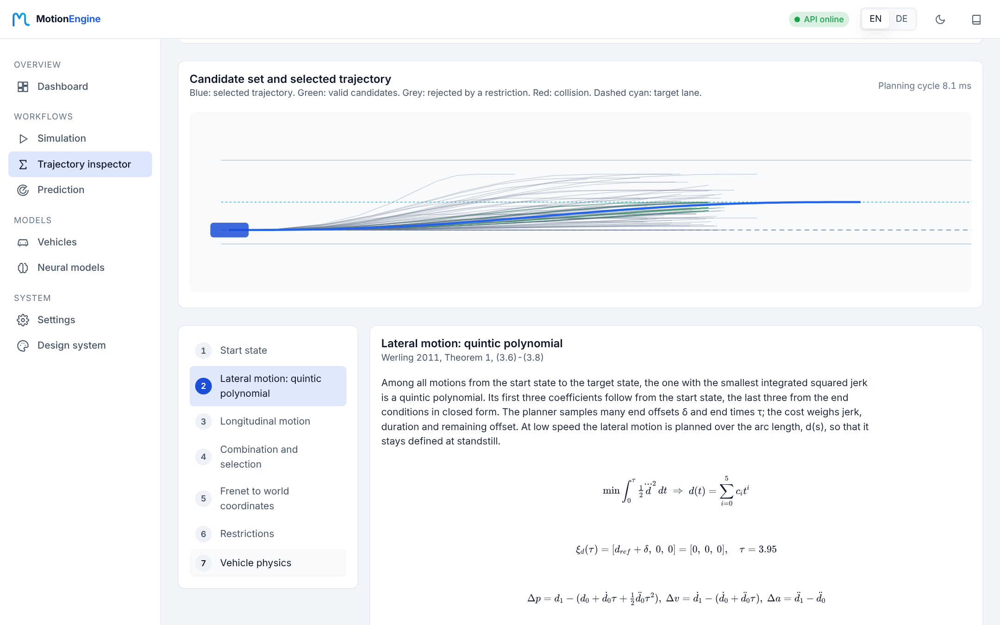
</picture>

<sub>The trajectory inspector re-derives one planning cycle step by step: every formula with the numbers the planner used.</sub>

</div>

---

## Why MotionEngine

| | |
|---|---|
| **Explainable, not a black box** | Every planned trajectory can be opened in the trajectory inspector: start state, quintic and quartic polynomials with their coefficients, cost terms, selection among all candidates, Frenet → world transform, restrictions and the single-track physics behind it. The coefficients are re-derived independently and match the planner to 2·10⁻¹⁶. |
| **Faithful to the paper** | The Werling planner implements Werling (2011) closely, including the time-consistent replanning: changing the replanning period changes the result by 0.00 cm, while a naive Frenet planner drifts by 6.5 cm. Each step cites the section and equation it implements. |
| **Physics at the fidelity you need** | Five vehicle models from a 4-state kinematic bicycle to a 24-state multibody model, three tire models (linear, Pacejka Magic Formula, brush), powertrain, brakes, actuators with latency, ABS/TCS/ESP. All models share one interface and run faster than real time. |
| **Neural vehicle models included** | Train a neural surrogate of any physics model in seconds without extra frameworks, or connect your own ONNX file or HTTP endpoint. A closed-loop comparison against the physics model shows how far you can trust it before you use it in a simulation. |
| **Ready to deploy** | REST API with OpenAPI, API key, concurrency and runtime limits, Prometheus metrics and a Docker image that ships the web app. `docker compose up` gives you the whole platform on port 8000. |
| **Tested and measured** | 860+ tests including physical plausibility, Monte Carlo and scenario regression against golden KPIs; CI on Linux and Windows with Python 3.10–3.13, CodeQL and secret scanning. Every performance number in this README is reproducible with `benchmarks/run_benchmarks.py`. |
| **Just ask** | The assistant in the web app turns a sentence like *"double lane change at 100 km/h on a wet road with the sports car"* into simulations and plans, runs them with the real models and explains the numbers. It answers in English or German. |
| **Built to be extended** | Vehicle models, tire models, controllers, maneuvers and planner nodes plug into a registry: add a component without touching the core, in Python, C++ or Rust. |

---

## Web app

A browser UI on top of the REST API, in **English and German**, with a **dark and a light theme**. It works on a phone as well.

| Trajectory inspector: vehicle physics | Neural models: training and closed-loop validation |
|---|---|
| 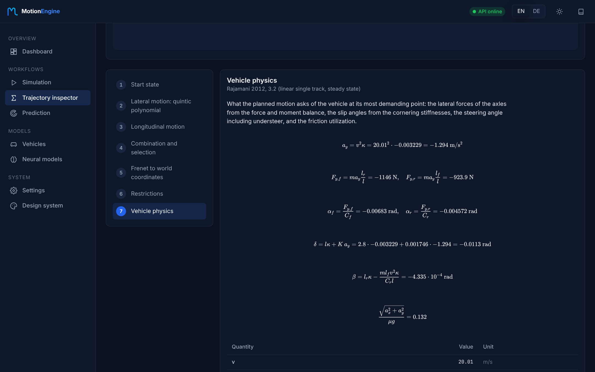 | 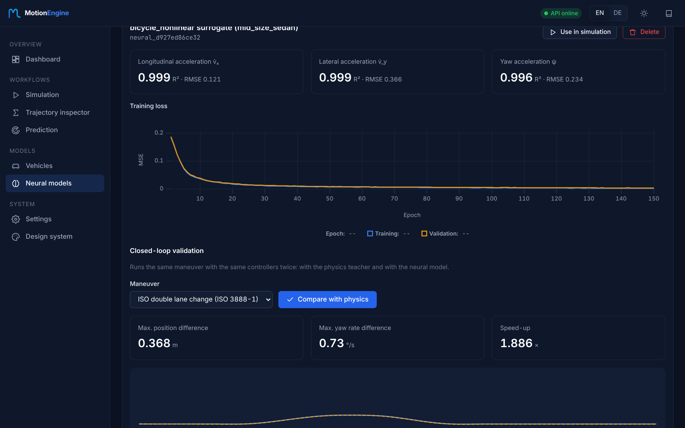 |

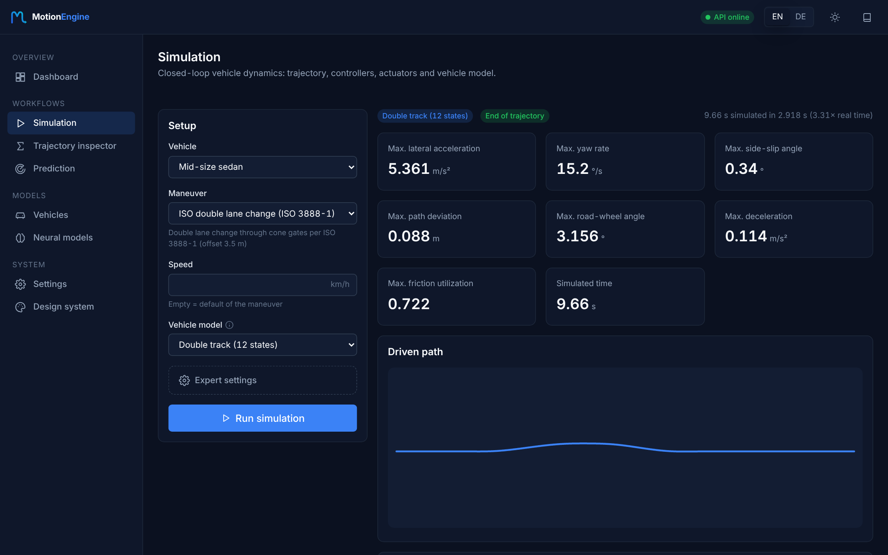

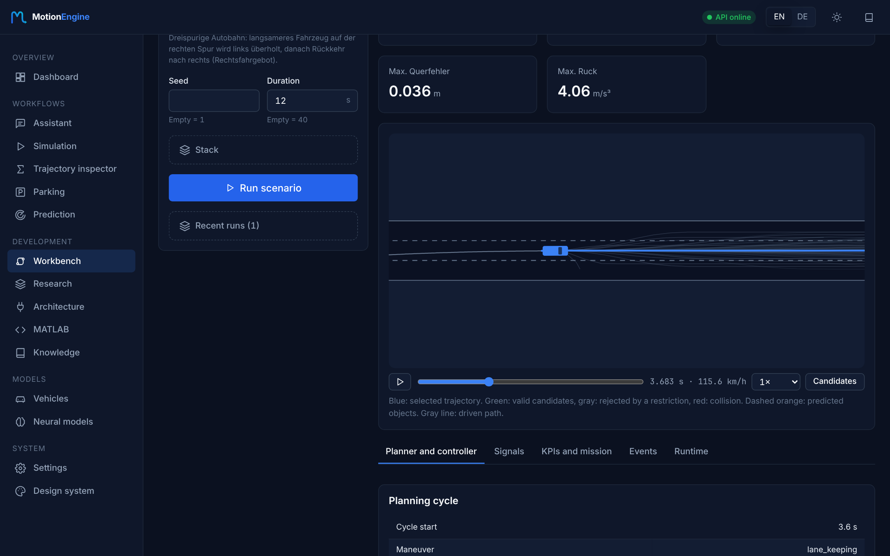

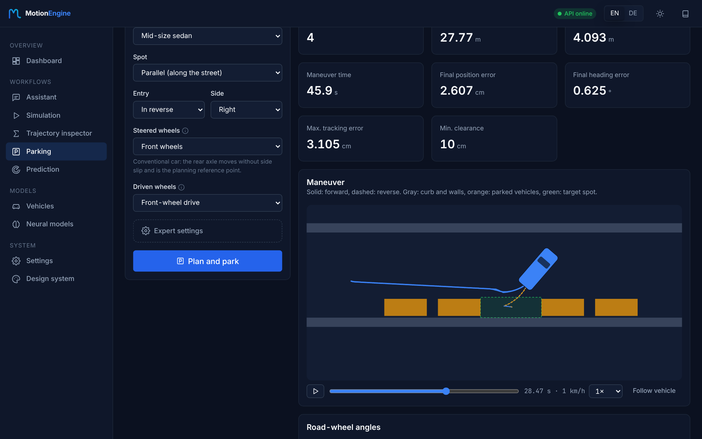

| Page | What it does |
|---|---|
| **Assistant** | type what you want to try; Claude runs simulations, planning cycles and predictions with MotionEngine's tools, shows each result as a card with KPIs and plots, and explains it |
| **Learn** | nine lessons on tracking control, planning and the whole system: a question, a real experiment, the numbers, the answer |
| **Controller lab** | Pure Pursuit, Stanley, LQR, MPC and the Werling controller on the same path and vehicle; KPIs, signals and the control law with the value of every term at any moment; friction, actuator dynamics, side force |
| **Simulation** | maneuver, vehicle, vehicle model and controllers; KPIs with units, time series and top view; run comparison (KPI table, overlaid paths and signals), PDF report, save and load runs |
| **Trajectory editor** | draw a path through draggable waypoints with corner radii, limit the speed by lateral acceleration, add a friction map, then drive it in the simulation |
| **Trajectory inspector** | one planning cycle in seven steps, each with formula, values, source and chart |
| **Workbench** | run the complete automated-driving stack on one of 14 scenarios; choose the component and parameters of every layer; animated top view with candidates and selected trajectory of each planning cycle; cost terms, signals, KPIs, mission criteria, events and runtime per node; live mode with pause and single step; conditions from ideal to realistic (double-track vehicle, actuator dynamics, sensor noise and latency, friction); parameter dialog per component; download a result and load it again |
| **Research** | compare components of a layer, sweep a parameter or run Monte Carlo, with a KPI table and chart |
| **Architecture** | signal-flow graph of the stack with validation and the documentation of each component; remove and add connections, the Workbench runs the rewired stack |
| **MATLAB** | analyze MATLAB functions and convert them to Python or C |
| **Knowledge** | search the knowledge graph (components, concepts, classes, equations) and 88 literature references |
| **Parking** | parallel, perpendicular or angled spots, forward or in reverse; front, rear-only or four-wheel steering; front, rear or all-wheel drive; animated maneuver with KPIs |
| **Neural models** | train an MLP surrogate of the vehicle dynamics or a network that proposes the planned trajectory (verified by the Werling planner); connect ONNX or HTTP models; compare every model with its teacher in closed loop; use it in simulations or in the stack |
| **Prediction, Vehicles, Settings** | object prediction, every vehicle parameter with unit and meaning, API address and key |

Every workflow runs with sensible defaults; advanced parameters sit behind *Expert settings*. The design system is
documented in [docs/design-system.md](docs/design-system.md), the redesign and its measurements in
[docs/ux/2026-11-08-redesign.md](docs/ux/2026-11-08-redesign.md).

---

## Quick start

**Everything in one container** (API, web app, model storage):

```bash
git clone https://github.com/alivsch-ai-code/MotionEngine.git && cd MotionEngine
docker compose up --build
```

Open http://localhost:8000 for the web app and http://localhost:8000/docs for the API reference.

**As a Python package:**

```bash
python -m venv .venv && source .venv/bin/activate    # Windows: .venv\Scripts\Activate.ps1
pip install -e ".[gui,api]"                          # core only: pip install -e .
```

```python
from vdsim.simulation.scenario import Scenario
from vdsim.simulation.simulator import Simulator
from vdsim.reporting import evaluate

scenario = Scenario(
    name="Double Lane Change",
    vehicle="sports_car",
    model="double_track",
    maneuver="iso_double_lane_change",
    maneuver_params={"speed_kmh": 90},
    lateral_controller="mpc",
    vehicle_overrides={"systems.esp_enabled": True},
)
result = Simulator.from_scenario(scenario).run()

for kpi in evaluate(result):
    print(f"{kpi.label}: {kpi.formatted()} {kpi.unit} [{kpi.rating}]")
```

---

## Features

| Area | What you get |
|---|---|
| **Parking** | Hybrid A* with Reeds-Shepp curves and multi-maneuver way out of tight spots, for front, rear-only and four-wheel steering; closed loop with traction limits per drive layout ([docs/planning/parking.md](docs/planning/parking.md)) |
| **Trajectory planning** | Werling planner in Frenet coordinates (quintic/quartic polynomials, jerk-optimal costs, lazy selection, time-consistent replanning, low-speed d(s) mode), circle-cover collision checking, behavior layer, object prediction |
| **Vehicle dynamics** | kinematic, linear and nonlinear bicycle, double track (12 states), multibody (24 states); linear, Pacejka MF and brush tires; ICE and electric powertrain, gearbox, brakes with EBD |
| **Control** | Stanley, Pure Pursuit, MPC, bi-level stabilization; ACC, AEB, lane keeping; ABS, TCS, ESP, torque vectoring, active suspension; actuator latency chains |
| **Automated driving** | full stack from scenario to actuators, 14 AD scenarios with missions and success criteria (overtaking, merging, cut-in, intersections, roundabout, evasion, parking) |
| **Analysis** | 22 ISO and ADAS test scenarios, automated KPI evaluation with ratings, PDF and Markdown reports, linear and quasi-static vehicle analysis, parameter sweeps |
| **Machine learning** | MLP surrogates trained against a physics teacher, ONNX and HTTP model backends, closed-loop validation, neural models usable as vehicle models; a learned trajectory planner that imitates the Werling planner and is verified by it ([method and results](docs/learning/trajectory_model.md)) |
| **Interfaces** | chat assistant (natural language → simulations and plans), web app (EN/DE), PySide6 desktop workbench with live top view and 3D view, REST API, Python library, command line |

---

## Performance

Measured with `benchmarks/run_benchmarks.py` on a 4-vCPU Xeon @ 2.1 GHz, single thread. Full tables in
[benchmarks/README.md](benchmarks/README.md).

| Measurement | Result |
|---|---:|
| Werling planning cycle, 18 000 candidates, free road (median) | **7.2 ms** |
| Werling planning cycle, 27 000 candidates, 10 obstacles (median) | 11.0 ms |
| Kinematic bicycle / double track / 24-state multibody | **13.8× / 3.2× / 2.4× real time** |
| REST: `POST /plan` (1 cycle) / `POST /predict` (50 objects) | 52 ms / 10 ms |
| Web app: first contentful paint of an app page | 124–144 ms |
| Peak memory of a 60 s simulation | 17 MiB |

The planner scales almost linearly: 8 400 → 68 400 candidates takes 6.5 → 10.9 ms, because the lazy selection only
checks the cheapest candidates.

---

## Where MotionEngine fits

| Project | Focus | How MotionEngine relates |
|---|---|---|
| Apollo, Autoware | production driving stacks (C++, ROS 2) | MotionEngine is a research and engineering tool: deeper vehicle dynamics, explainable planning, reproducible analysis in one Python package |
| CommonRoad | planning benchmarks and scenario format | similar audience; MotionEngine adds the closed loop with controllers, actuators and vehicle dynamics |
| CARLA | photorealistic simulation and sensors | complementary; MotionEngine can use CARLA for 3D visualization (`viz3d`) |
| highway-env | reinforcement learning environments | MotionEngine models the physics in far more detail; no RL interface yet |

The comparison is based on the public documentation of each project. Details are in the
[review report](docs/review/2026-11-08-full-review.md).

---

## Architecture

<div align="center">
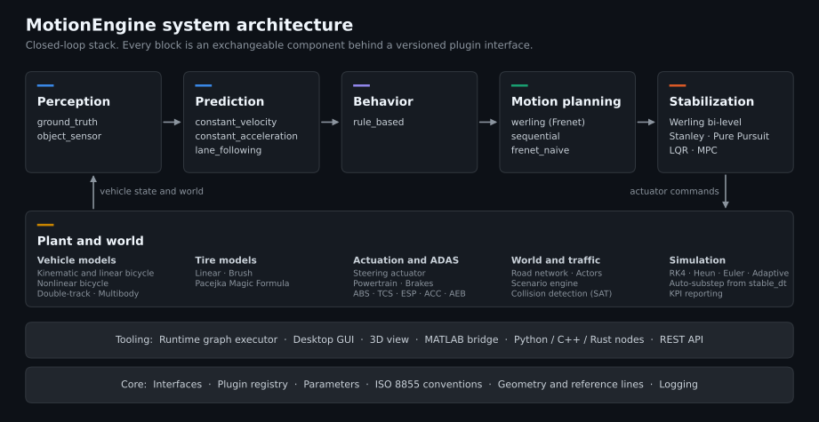
</div>

MotionEngine follows a layered architecture where dependencies point strictly downward. The simulation core accesses
all components through abstract interfaces (`vdsim.core.interfaces`) and a plugin registry. Adding a vehicle model,
tire model, controller or maneuver requires **no changes** to the core. See [docs/ARCHITECTURE.md](docs/ARCHITECTURE.md)
for data flow, UML diagrams and the extension API.

---

## Trajectory Planning

The planning module implements the Werling optimal trajectory generation approach in curvilinear (Frenet) coordinates.

<div align="center">
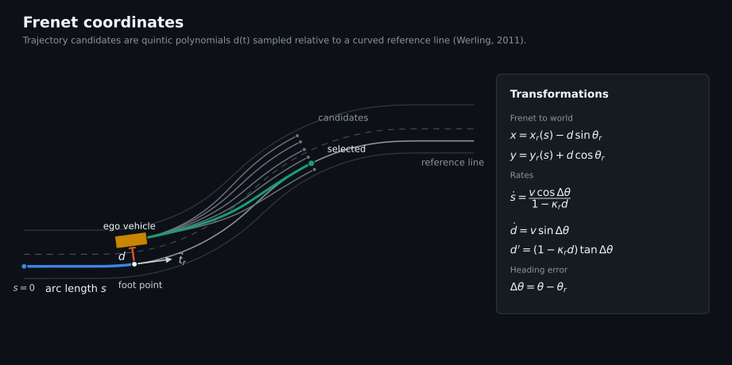
</div>

<div align="center">
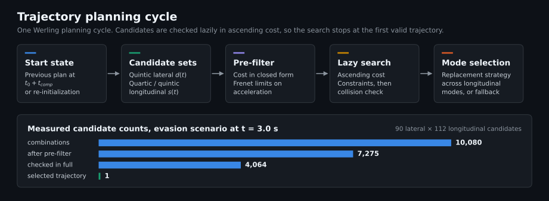
</div>

**Pipeline stages:**

| Stage | Method | Reference |
|---|---|---|
| Lateral sampling | Quintic polynomials in Frenet d-coordinate | Werling (2011), eq. 3.6–3.8 |
| Longitudinal sampling | Quartic/quintic polynomials for velocity/position | Werling (2011), eq. 3.9–3.12 |
| Combination | Frenet → Cartesian via reference line projection | Werling (2011), Appendix A |
| Constraint checking | Curvature, acceleration, jerk, steering, stability | Configurable bounds |
| Collision detection | Circle-covering method | Ziegler & Stiller (2010) |
| Cost evaluation | Weighted jerk + deviation + time + comfort + energy | Werling (2011), eq. 3.13 |
| Trajectory stitching | Smooth continuation from previous planning cycle | |

---

## Vehicle Dynamics

<div align="center">
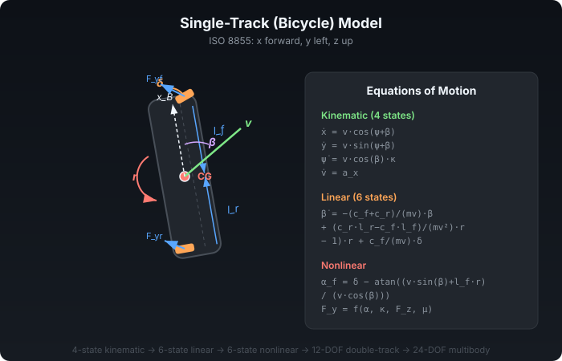
</div>

Five fidelity levels, all validated against analytical solutions. The single-track model is also compared with
46 hours of measurements from four production cars ([method and results](docs/validation/measured_data.md)):

| Model | States | Capabilities |
|---|---|---|
| **Kinematic bicycle** | 4 | Ackermann geometry, rear-axle steering, path planning |
| **Linear bicycle** | 6 | State-space form, frequency response, stability analysis |
| **Nonlinear bicycle** | 6 | Tire model coupling, friction ellipse, load transfer |
| **Double-track** | 12 | Roll dynamics, wheel spin, per-wheel friction, ESP/ABS |
| **Multibody** | 24 | Heave/roll/pitch, unsprung masses, road excitation, ISO 2631 |

**Tire models:** Linear (with friction circle), Pacejka Magic Formula (load-dependent, combined slip, camber), Brush model (parabolic pressure, isotropic combined slip).

---

## Visual Examples

All figures come from real simulation runs. Regenerate them with `python scripts/generate_readme_figures.py`.

### Evasion around a parked car with oncoming traffic

The Werling planner optimizes lateral and longitudinal motion together: it slows down further and lets the oncoming car pass first. The sequential baseline fixes the speed profile before it plans laterally.

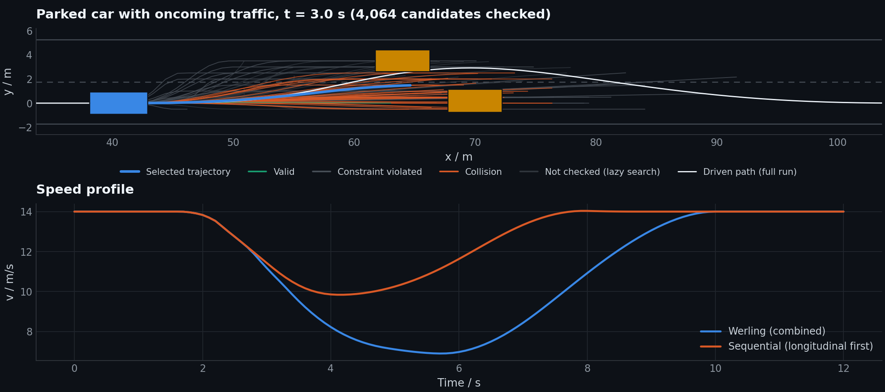

### Temporal consistency

Changing the replanning period does not change the Werling result (0.00 cm deviation). A naive Frenet planner with a relative time grid deviates by up to 6.5 cm.

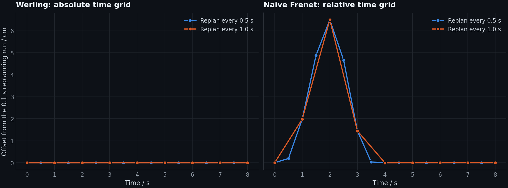

### Tracking controllers

Lateral error on a double lane change from 15 to 20 m/s, starting with a 0.3 m offset.

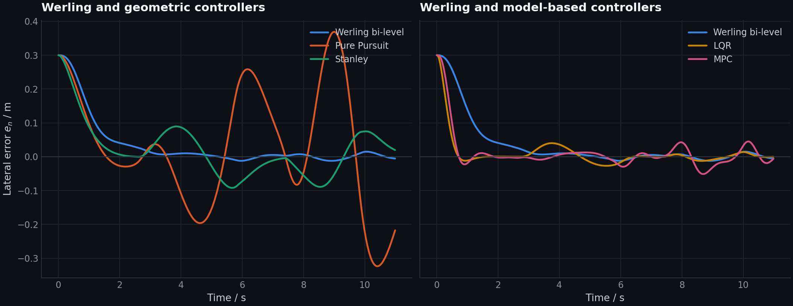

### Side-wind gust at 30 m/s

Bi-level stabilization re-initializes the trajectory at the predicted vehicle state instead of steering back onto the old one.

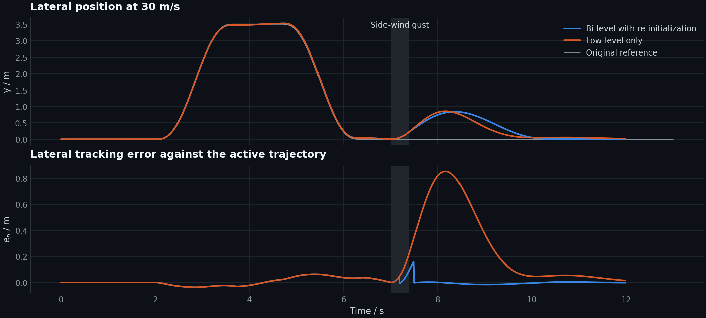

<details>
<summary><b>More examples: lane change, following, stopping, low-speed tracking</b></summary>

<br/>

**Lane change at 20 m/s**

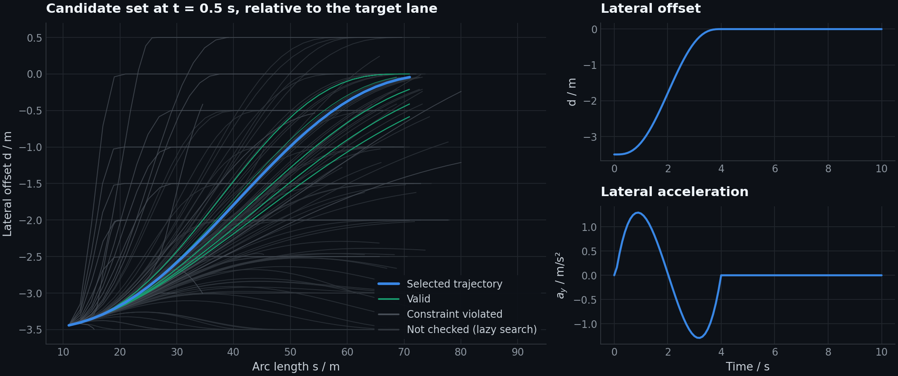

**Following a braking lead vehicle**

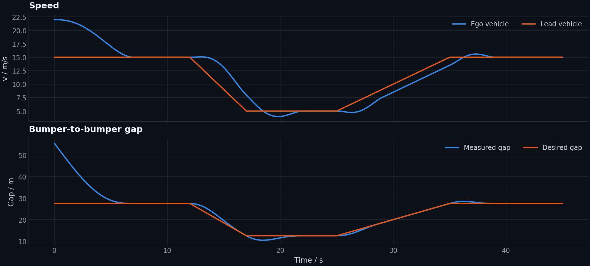

**Stopping at a stop line**

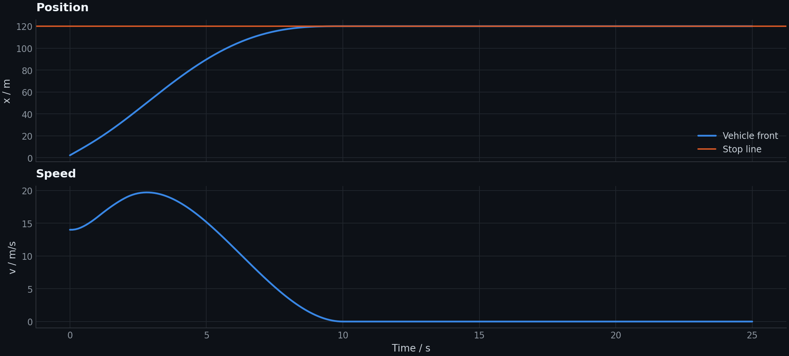

**Low-speed stop-and-go tracking, forward and reverse**

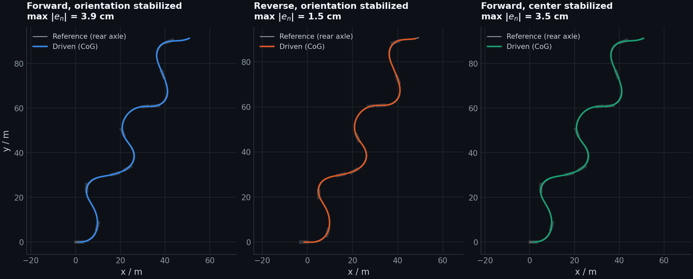

</details>

---

## Usage

### Web app and REST API

```bash
cd web && npm ci && npm run build && cd ..
MOTIONENGINE_WEB_DIR=web/dist motion-engine-api --port 8000   # web app on http://localhost:8000/
```

For web development, run `npm run dev` in `web/` (Vite on port 5173, proxies the API on port 8000).

```bash
curl -s -X POST localhost:8000/simulate -H "Content-Type: application/json" \
     -d '{"model": "bicycle_nonlinear", "maneuver": "iso_double_lane_change", "signals": ["t", "ay"]}'
```

Endpoints: `/health`, `/metrics` (Prometheus), `/vehicle`, `/vehicle/{preset}`, `/trajectory`, `/simulate`, `/plan`,
`/plan/explain`, `/park`, `/predict`, `/workbench` (catalog, runs, live sessions, import, experiments), `/trajectory/waypoints`, `/simulate/report`, `/matlab`, `/knowledge`, `/models` (train, jobs, connect, evaluate), `/chat` (assistant, server-sent events).

| Variable | Effect |
|---|---|
| `MOTIONENGINE_API_KEY` | require the header `X-API-Key` |
| `MOTIONENGINE_MAX_CONCURRENCY`, `MOTIONENGINE_MAX_SIM_TIME`, `MOTIONENGINE_MAX_WALL_TIME` | bound the load |
| `MOTIONENGINE_WEB_DIR` | serve the built web app |
| `MOTIONENGINE_MODEL_DIR` | where neural models are stored |
| `MOTIONENGINE_CHAT_RATE` | chat messages per minute and client address (default 20) |
| `MOTIONENGINE_ALLOWED_MODEL_HOSTS` | hosts that HTTP models may use |
| `MOTIONENGINE_CONFIG_DIR` | location of `configs/` for a wheel install outside the source tree |
| `ANTHROPIC_API_KEY` | enables the assistant (`pip install -e ".[chat]"`); `MOTIONENGINE_CHAT_MODEL` and `MOTIONENGINE_CHAT_EFFORT` choose the model and effort |

Connecting ONNX models needs `pip install -e ".[api,ml]"`. A devcontainer (`.devcontainer/`) installs `.[dev,api]` for
VS Code and Codespaces.

### Desktop GUI

```bash
python run_gui.py
```

### Command line

```bash
python run_scenario.py --list                           # List all scenarios
python run_scenario.py iso_doppelspurwechsel_80 --plot   # ISO double lane change
python run_scenario.py kreisfahrt_r40 --report report.pdf --summary report.md
python run_scenario.py --all                             # Run all 22 scenarios
```

### Tests

```bash
pytest                           # All tests
pytest -m "not slow"             # All tests except tests marked slow
cd web && npm test               # Web app: i18n checks
```

---

## Extending MotionEngine

All exchangeable components use a plugin registry. No core changes needed:

<details>
<summary><b>Add a custom tire model</b></summary>

```python
import numpy as np
from vdsim.core.interfaces import TireModel
from vdsim.core.registry import register

@register("tire_model", "tanh")
class TanhTire(TireModel):
    def __init__(self, cornering_stiffness, longitudinal_stiffness, nominal_load, **_):
        self.ca, self.ck, self.fz0 = cornering_stiffness, longitudinal_stiffness, nominal_load

    def forces(self, alpha, kappa, fz, mu=1.0, camber=0.0):
        limit = mu * np.maximum(fz, 0.0)
        fy = limit * np.tanh(self.ca * fz / self.fz0 * alpha / np.maximum(limit, 1e-9))
        fx = limit * np.tanh(self.ck * fz / self.fz0 * kappa / np.maximum(limit, 1e-9))
        return fx, fy, np.zeros_like(fy)
```

Then set `tires.model = "tanh"` in the vehicle config — all vehicle models pick it up automatically.
</details>

<details>
<summary><b>Add a custom maneuver</b></summary>

```python
from vdsim.trajectory.trajectory_generator import PathBuilder, maneuver, KMH

@maneuver("highway_exit", "Highway Exit", "Road", "Lane change with tightening curve",
          speed_kmh=("Speed", "km/h"))
def highway_exit(speed_kmh=100.0):
    b = PathBuilder().straight(200).offset(150, 3.75).straight(100)
    b.turn(250, 45, transition=60).clothoid(80, 1/80.0).arc(80, 60)
    return b.build(v_default=speed_kmh * KMH)
```

The maneuver appears automatically with its parameter form in the desktop GUI, in the web app and under `GET /trajectory/maneuvers`.
</details>

<details>
<summary><b>Add a custom controller</b></summary>

```python
from vdsim.core.interfaces import LateralController
from vdsim.core.registry import register

@register("lateral_controller", "my_controller")
class MyController(LateralController):
    def steer(self, t, state, reference):
        # Your control law here
        return steering_angle
```
</details>

See [examples/custom_nodes/](examples/custom_nodes/) for complete examples in Python, C++, and Rust.

---

## Pre-Built Scenarios

22 ready-to-run vehicle dynamics scenarios (`configs/scenarios/`, run with `run_scenario.py`) covering standard test maneuvers and real-world situations:

| Category | Scenarios |
|---|---|
| **ISO Standards** | Double lane change (3888-1), obstacle avoidance (3888-2), steady-state circular (4138), step steer & frequency response (7401), sine with dwell (FMVSS 126), braking in curve (7975) |
| **Dynamic Maneuvers** | Slalom, figure-eight, emergency evasion, full braking (ABS), split-mu braking, 0–100 km/h EV |
| **ADAS Functions** | Highway with ACC, highway with lane keeping, emergency braking (AEB), lane change with latency chain |
| **Complex Scenarios** | City driving, race track with optimal speed profile, comfort road class C, customer test cycle |

Vehicle presets: mid-size sedan (ICE/RWD), electric sedan (AWD), sports car, SUV.

14 automated driving scenarios (`configs/ad_scenarios/`, full planning and control stack in the desktop GUI's AD workbench)
with mission and success criteria: highway overtaking and exit, merging next to a truck, cut-in, cut-out at a traffic jam,
rural overtaking, urban driving, intersections with traffic lights and right of way, roundabout, emergency evasion,
traffic density, the highway experiment from Werling (2011) and reverse parallel parking.

---

## Project Structure

```
MotionEngine/
├── vdsim/                      Core library
│   ├── core/                   Interfaces, registry, parameters, ISO 8855 conventions
│   ├── vehicle_models/         Bicycle (kin/lin/NL), double-track, multibody
│   ├── tire_models/            Linear, Pacejka MF, brush
│   ├── powertrain/             ICE, electric motor, gearbox, brakes (EBD)
│   ├── actuators/              Latency chain, steering actuator, characteristic
│   ├── controllers/            Stanley, Pure Pursuit, MPC, ACC, AEB, ESP, ABS, ...
│   ├── planning/               Werling planner, cost, constraints, collision
│   ├── stabilization/          Tracking controllers, vehicle layers
│   ├── trajectory/             Trajectory model, generators, loaders, OpenDRIVE
│   ├── simulation/             Solver (RK4/Heun/Euler), simulator, scenarios
│   ├── analysis/               Linear & quasi-static vehicle analysis
│   ├── reporting/              KPIs, PDF/Markdown reports
│   ├── ad/, world/             Automated driving stack, AD scenarios and missions
│   ├── prediction/             Object prediction
│   ├── service/                REST API (FastAPI), trajectory derivation (/plan/explain)
│   ├── learning/               Neural vehicle models (MLP training, ONNX/HTTP backends)
│   ├── visualization/          Plots, animation, dashboard widgets
│   └── gui/                    PySide6 desktop application
├── web/                        Web app (React, TypeScript, Vite; locales en/de)
├── configs/                    Vehicle presets, scenario library, trajectories
├── tests/                      pytest suite (~67 test files)
├── examples/                   Planning, stabilization, custom nodes
├── docs/                       Architecture, references, design system, brand assets, reviews
├── benchmarks/                 Performance benchmarks
├── scripts/                    Build and utility scripts
└── .github/                    CI/CD, issue templates, PR template
```

---

## Conventions

| Convention | Standard |
|---|---|
| **Coordinate system** | ISO 8855 — x forward, y left, z up |
| **Units** | SI internally; degrees/km/h only at GUI and report boundaries |
| **Wheel order** | FL, FR, RL, RR in all arrays |
| **Steer sign** | Positive = left |
| **Slip angle** | Positive α → positive lateral force |
| **Longitudinal slip** | κ = (ωR − v)/\|v\|, positive when driving |

---

## Requirements

| Component | Packages |
|---|---|
| **Core** | Python 3.10+, NumPy, SciPy, Matplotlib, PyYAML |
| **GUI** (optional, `[gui]`) | PySide6, pyqtgraph, PyOpenGL |
| **REST API** (optional, `[api]`) | FastAPI, uvicorn, httpx |
| **ONNX models** (optional, `[ml]`) | onnxruntime |
| **Assistant** (optional, `[chat]`) | anthropic; needs an Anthropic API key |
| **Web app** (build only) | Node.js 22, npm; the Docker image contains the built app |
| **Development** | pytest, ruff, mypy, pre-commit |

---

## Roadmap

See [ROADMAP.md](ROADMAP.md) for the full development plan.

**Next milestones:**
- Pacejka MF 6.2 with TIR file import
- Tire relaxation length (transient behavior)
- OpenSCENARIO import
- Sensor models (camera/radar)
- English localization of the desktop GUI and CLI (the web app is already English/German)
- FMI/FMU co-simulation

---

## References

The vehicle dynamics models and trajectory planning algorithms are based on established research:

| Topic | Reference |
|---|---|
| **Trajectory Planning** | Werling, M. (2011). *Optimal trajectory generation for dynamic street scenarios in a Frenet frame.* KIT Scientific Publishing. [DOI: 10.5445/KSP/1000021738](https://doi.org/10.5445/KSP/1000021738) |
| **Vehicle Dynamics** | Rajamani, R. (2012). *Vehicle Dynamics and Control.* 2nd ed., Springer. [DOI: 10.1007/978-1-4614-1433-9](https://doi.org/10.1007/978-1-4614-1433-9) |
| **Tire Modeling** | Pacejka, H.B. (2012). *Tire and Vehicle Dynamics.* 3rd ed., Butterworth-Heinemann. [DOI: 10.1016/C2010-0-68548-8](https://doi.org/10.1016/C2010-0-68548-8) |
| **Collision Checking** | Ziegler, J. & Stiller, C. (2010). *Fast collision checking for intelligent vehicle motion planning.* IEEE IV 2010. |

See [docs/references/](docs/references/) for the complete reference collection organized by module.

---

## Governance

MotionEngine is reviewed by specialized agents for architecture, planning, dynamics, mathematics, physics, performance, testing, documentation, research, repository health and releases. [AGENTS.md](AGENTS.md) explains the review flow, and works with Claude Code, GitHub Copilot, Cursor, Cline and Roo Code.

---

## Citation

If MotionEngine helps your research, please cite it:

```bibtex
@software{motionengine,
  author = {Schmidt, Aljoscha Vivien},
  title  = {MotionEngine: Motion Planning and Vehicle Dynamics Simulation},
  year   = {2026},
  url    = {https://github.com/alivsch-ai-code/MotionEngine}
}
```

---

## Contributing

See [CONTRIBUTING.md](CONTRIBUTING.md) for guidelines. The plugin architecture makes it straightforward to add new components without modifying the core.

## License

[MIT License](LICENSE) — Copyright (c) 2026 Aljoscha Vivien Schmidt
