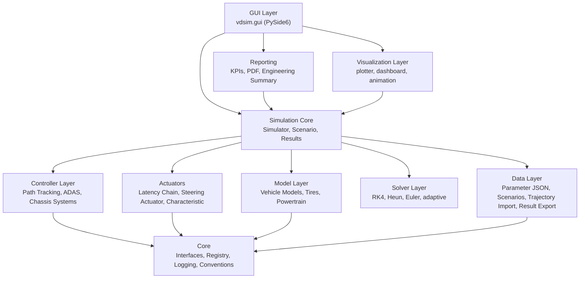
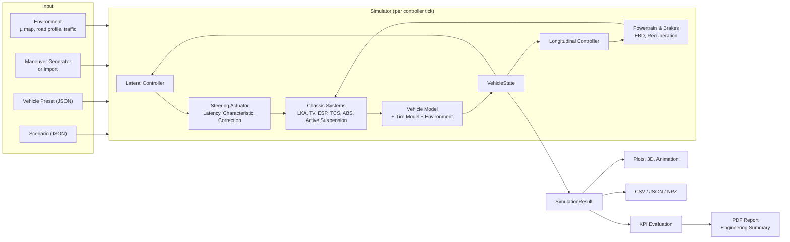
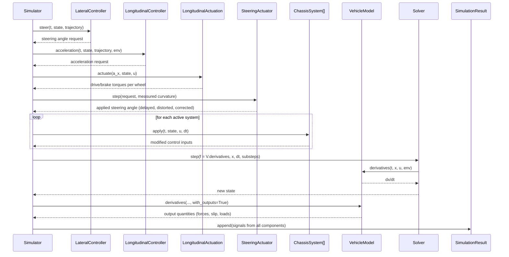

# MotionEngine — Architecture

`vdsim` is a modular Python platform for vehicle dynamics simulation, controller development, and virtual validation. This document describes the system architecture, data flow, classes and modules, the GUI concept, directory structure, usage examples, and the extension API.

Contents:

1. [Layered Architecture](#1-layered-architecture)
2. [Data Flow](#2-data-flow)
3. [Simulation Step Sequence (UML)](#3-simulation-step-sequence)
4. [Class Structure (UML)](#4-class-structure)
5. [Module Overview](#5-module-overview)
6. [Vehicle, Tire, and Controller Models](#6-models)
7. [Conventions](#7-conventions)
8. [GUI Concept](#8-gui-concept)
9. [Directory Structure](#9-directory-structure)
10. [Usage Examples](#10-usage-examples)
11. [Extension API](#11-extension-api)
12. [Validation and Testing](#12-validation-and-testing)
13. [Known Limitations](#13-known-limitations)

---

## 1. Layered Architecture



| Layer | Package | Responsibility |
|---|---|---|
| Core | `vdsim.core` | Abstract interfaces, plugin registry, parameter dataclasses, logging, units, and sign conventions |
| Model Layer | `vdsim.vehicle_models`, `vdsim.tire_models`, `vdsim.powertrain` | Equations of motion, tire forces, powertrain and brakes |
| Solver Layer | `vdsim.simulation.solver` | Numerical integration with stability-dependent sub-stepping |
| Actuators | `vdsim.actuators` | Dead time, PT1, latency chain, actuator characteristic, feedback correction |
| Controller Layer | `vdsim.controllers` | Path tracking, longitudinal control, ADAS functions, chassis control systems |
| Simulation Core | `vdsim.simulation` | Closing the control loop, managing scenarios, recording results |
| Data Layer | `core.parameters`, `simulation.scenario`, `simulation.results`, `trajectory.trajectory_loader` | JSON parameters and scenarios, trajectory import, result export (CSV/JSON/NPZ) |
| Analysis | `vdsim.analysis` | Quasi-static and linear vehicle analysis |
| Reporting | `vdsim.reporting` | KPI computation, run comparison, PDF and Markdown reports |
| Visualization | `vdsim.visualization` | Matplotlib plots, real-time widgets, animation |
| GUI Layer | `vdsim.gui` | Desktop application |

Dependencies point strictly downward. The Simulation Core accesses all components exclusively through the interfaces defined in `vdsim.core.interfaces` and the plugin registry.

## 2. Data Flow



## 3. Simulation Step Sequence



The number of sub-steps is determined by the stability limit of the explicit RK4 scheme (`VehicleModel.stable_dt`). Wheel-spin dynamics become stiff at low speed; at highway speed, a 2 ms step size is sufficient.

## 4. Class Structure

```mermaid
classDiagram
    class TireModel {
        <<abstract>>
        +forces(alpha, kappa, fz, mu, camber) (fx, fy, mz)
    }
    TireModel <|-- LinearTire
    TireModel <|-- PacejkaTire
    TireModel <|-- BrushTire

    class VehicleModel {
        <<abstract>>
        +config: VehicleConfig
        +state_names
        +initial_state(x, y, psi, speed)
        +derivatives(t, s, u, env, with_outputs)
        +vehicle_state(t, s, outputs) VehicleState
        +stable_dt(s)
    }
    VehicleModel <|-- KinematicBicycleModel
    VehicleModel <|-- LinearBicycleModel
    VehicleModel <|-- NonlinearBicycleModel
    VehicleModel <|-- DoubleTrackModel
    VehicleModel <|-- MultibodyModel
    VehicleModel o-- TireModel

    class LateralController {
        <<abstract>>
        +steer(t, state, reference) float
    }
    LateralController <|-- StanleyController
    LateralController <|-- PurePursuitController
    LateralController <|-- MPCController
    LateralController <|-- LaneKeepingAssist
    LateralController <|-- OpenLoopSteering
    LateralController <|-- CurvatureFeedforward

    class LongitudinalController {
        <<abstract>>
        +acceleration(t, state, reference, env) float
    }
    LongitudinalController <|-- SpeedController
    LongitudinalController <|-- AdaptiveCruiseControl
    LongitudinalController <|-- EmergencyBrakeAssist

    class ChassisSystem {
        <<abstract>>
        +apply(t, state, u, dt) ControlInput
    }
    ChassisSystem <|-- AntiLockBraking
    ChassisSystem <|-- TractionControl
    ChassisSystem <|-- ElectronicStabilityProgram
    ChassisSystem <|-- RearAxleSteering
    ChassisSystem <|-- TorqueVectoring
    ChassisSystem <|-- ActiveRollStabilization
    ChassisSystem <|-- SkyhookDamping

    class Simulator {
        +from_scenario(scenario)$
        +step() VehicleState
        +run(progress) SimulationResult
    }
    Simulator o-- VehicleModel
    Simulator o-- LateralController
    Simulator o-- LongitudinalController
    Simulator o-- ChassisSystem
    Simulator o-- SteeringActuator
    Simulator o-- LongitudinalActuation
    Simulator o-- Environment
    Simulator o-- Trajectory
    Simulator --> SimulationResult

    class Scenario {
        +build_config() VehicleConfig
        +build_trajectory(config) Trajectory
        +save(path) / load(path)
    }
    class VehicleConfig {
        vehicle, tires, chassis
        powertrain, brakes, systems
    }
    class Trajectory {
        x, y, psi, kappa, v, s
        cones, boundaries
        steer_table, accel_table
        +project(x, y, hint) Projection
    }
    class SteeringActuator {
        LatencyChain
        steering_characteristic
        CurvatureCorrection
    }
    class LongitudinalActuation {
        Powertrain
        BrakeSystem (EBD)
    }
    class KPIEvaluator {
        +evaluate(result) KPI[]
    }
    KPIEvaluator --> SimulationResult
```



Data objects: `VehicleState` (unified view of the vehicle state for controllers and sensor interfaces), `ControlInput` (front/rear steering angle, drive/brake torque per wheel, active roll moment, active damper forces), `Projection` (result of path projection).

## 5. Module Overview

| Module | Contents |
|---|---|
| `core/conventions.py` | ISO 8855, wheel order FL/FR/RL/RR, gravitational constant |
| `core/parameters.py` | Dataclasses for vehicle, tires, suspension, powertrain, brakes, control systems (with label, unit, bounds); JSON serialization |
| `core/interfaces.py` | `TireModel`, `VehicleModel`, `LateralController`, `LongitudinalController`, `ChassisSystem`, `Sensor` |
| `core/registry.py` | Plugin registry (`register`, `create`, `available`) |
| `core/logging_setup.py` | Console and rotating log file `logs/vdsim.log` |
| `tire_models/linear_tire.py` | Linear model with friction circle |
| `tire_models/pacejka.py` | Magic Formula: load-dependent stiffness and friction, camber, combined slip, aligning torque |
| `tire_models/brush_model.py` | Brush model with parabolic pressure distribution, combined slip |
| `vehicle_models/bicycle_model.py` | Single-track (bicycle) model: kinematic, linear (state-space), nonlinear (tire model, friction ellipse) |
| `vehicle_models/double_track_model.py` | Double-track model, 12 states: roll, wheel spin, load transfer, camber, roll steer |
| `vehicle_models/multibody_model.py` | Multibody model, 24 states: heave, roll, pitch, 4 unsprung masses, wheel spin, road excitation |
| `powertrain/engine.py` | ICE torque map, automatic gearbox, electric motor with recuperation limits |
| `powertrain/powertrain.py` | Powertrain layout, brake system with EBD, longitudinal actuation including recuperation blending and energy balance |
| `actuators/latency.py` | Dead time, PT1, latency chain (gateway / actuator / odometry) |
| `actuators/steering_characteristic.py` | Actuator characteristic error, theoretical correction factor |
| `actuators/steering_actuator.py` | Platform steering actuator: characteristic, latency, rate limiter, feedback correction |
| `controllers/stanley_controller.py` | Stanley with sideslip compensation and feedforward |
| `controllers/pure_pursuit.py` | Pure Pursuit with speed-dependent look-ahead distance |
| `controllers/mpc_controller.py` | Linear MPC with curvature preview and steering angle bounds |
| `controllers/open_loop.py` | Open-loop steering from table, pure curvature feedforward |
| `controllers/speed_controller.py` | PI speed controller, ACC, emergency brake assist (AEB) |
| `controllers/lane_keeping.py` | Lane keeping assist with distracted driver model |
| `controllers/curvature_feedback.py` | Feedback estimator for curvature error |
| `controllers/slip_control.py` | ABS, TCS |
| `controllers/esp_controller.py` | ESP (yaw rate control via individual wheel braking), reference yaw rate |
| `controllers/rear_axle_steering.py` | Rear axle steering (counter-phase / in-phase) |
| `controllers/torque_vectoring.py` | Torque vectoring with configurable target understeer behavior |
| `controllers/active_suspension.py` | Active roll stabilization, skyhook damping |
| `trajectory/trajectory.py` | Trajectory, projection (continuous and robust for closed tracks), serialization |
| `trajectory/trajectory_generator.py` | Path builder and all maneuvers (ISO, driving maneuvers, tracks, test cycles) |
| `trajectory/speed_profile.py` | GGV-limited speed profile, lap time |
| `trajectory/trajectory_loader.py` | Import: CSV, JSON, GPX, NMEA, MATLAB, ROS path, OpenDRIVE |
| `trajectory/opendrive.py` | OpenDRIVE reference line (line, arc, clothoid, poly3, paramPoly3) and lanes |
| `trajectory/waypoint_editor.py` | Waypoint model with fillet radii, undo, JSON |
| `simulation/solver.py` | Euler, Heun, RK4, adaptive (scipy) |
| `simulation/vehicle_state.py` | `VehicleState`, `ControlInput` |
| `simulation/environment.py` | Friction map, road profile (ISO 8608), wind, lead vehicle |
| `simulation/simulator.py` | Control loop, termination conditions, logging |
| `simulation/scenario.py` | Scenario definition and management |
| `simulation/results.py` | Time series, export and import |
| `analysis/linear_analysis.py` | Understeer gradient, gains, eigenvalues, Bode diagram |
| `analysis/quasi_static.py` | Wheel loads, roll gradient, roll axis, lateral load distribution, camber, steering kinematics |
| `reporting/kpi_evaluator.py` | General and maneuver-specific KPIs, ISO 2631, run comparison |
| `reporting/report_generator.py` | PDF report, engineering summary |
| `visualization/plotter.py` | Path, state variables, tires, Pacejka curves, GGV diagram, Bode, heatmaps, energy, comparison |
| `visualization/dashboard.py` | Real-time widgets: top view, signal scope, KPI tiles, 3D view |
| `visualization/animation.py` | Top-view animation as GIF/MP4 |
| `gui/*` | Main window, panels, theme, automatic parameter forms |

## 6. Models

### Vehicle Models

| Model | States | Includes | Validity / Use Case |
|---|---|---|---|
| Kinematic bicycle | 4 | Ackermann geometry, driving resistances | Low lateral acceleration, path planning, latency studies |
| Linear bicycle | 6 | Linear tires, state-space A, B matrices | Controller design, frequency response, stability (a_y < ~4 m/s²) |
| Nonlinear bicycle | 6 | Tire model per axle, longitudinal load transfer, friction ellipse | Limit handling without roll, fast parameter sweeps |
| Double-track | 12 | Roll dynamics, wheel spin, load transfer, camber, roll steer, per-wheel friction | Limit handling, ABS/TCS/ESP, torque vectoring, split-µ |
| Multibody | 24 | Heave/roll/pitch, unsprung masses, tire spring, anti-dive/-squat, road excitation | Ride comfort (ISO 2631), wheel load fluctuation, active suspension |

### Tire Models

Linear (with friction circle), Pacejka Magic Formula (reduced parameter set, load-degressive stiffness, load-dependent friction, camber, combined slip via weighting functions), and brush model (parabolic pressure distribution, isotropic combined slip).

### Controllers and Chassis Systems

- **Path tracking:** Stanley, Pure Pursuit, MPC, open-loop steering from table (ISO steer maneuvers), curvature feedforward.
- **Longitudinal control:** PI speed controller with feedforward, ACC, AEB with standstill hold.
- **ADAS:** Lane keeping assist with driver model, ACC, AEB, trajectory following (MPC).
- **Chassis control systems:** ABS, TCS, ESP, rear axle steering, torque vectoring, active roll stabilization, skyhook damping, plus EBD and recuperation blending in the brake system.

## 7. Conventions

- SI units internally; degrees and km/h only at the GUI and report boundary.
- ISO 8855: x forward, y left, z up. Positive steering angle steers left, positive slip angle produces positive lateral force.
- Longitudinal slip `kappa = (omega R - v) / |v|` is positive when driving.
- Wheel order in all arrays: FL, FR, RL, RR.
- Roll angle > 0 lifts the left side (right lean in a left turn); pitch angle > 0 means nose down.

## 8. GUI Concept

```
┌────────────────────────────────────────────────────────────────────────────────────────────┐
│ File  Simulation  View  Help                                                               │
│ [▶ Start] [⏸ Pause] [⏹ Stop] | Playback [Realtime|2x|5x|Max] [x] Follow Camera | ████ 63% │
├───────────────────────┬────────────────────────────────────────────────────────────────────┤
│ ┌Scenario┬Vehicle┐    │ Live | Signals | 3D | Analysis | KPIs | Compare | Editor           │
│ │ Library           │  │ ┌──────┬──────┬──────┬──────┬──────┬──────┬──────┐               │
│ │ Model             │  │ │ v    │ a_y  │ a_x  │ r    │ β    │ δ    │ t    │  Tiles        │
│ │ Maneuver + Params │  │ └──────┴──────┴──────┴──────┴──────┴──────┴──────┘               │
│ │ Import            │  │                                                                  │
│ │ Controller / ADAS │  │        Top View: Reference, Cones, Track, Vehicle                │
│ │ Steering/Latency  │  │        with wheels, lead vehicle                                 │
│ │ Environment (µ, …)│  │                                                                  │
│ │ Simulation        │  │                                                                  │
│ └───────────────────┘  │                                                                  │
├───────────────────────┴────────────────────────────────────────────────────────────────────┤
│ Log                                                                                        │
└────────────────────────────────────────────────────────────────────────────────────────────┘
```

| Area | Function |
|---|---|
| Dock "Scenario" | Load/save from library, model selection, maneuver with parameters from the generator, trajectory import, lateral/longitudinal controller, steering actuator and latency chain, environment (µ, split-µ, road class, wind, lead vehicle), time step and integrator |
| Dock "Vehicle" | Presets, parameter tree (auto-generated from dataclasses with units and bounds), JSON import/export |
| Tab "Live" | Real-time top view with camera follow, KPI tiles |
| Tab "Signals" | Time series with synchronized time axis |
| Tab "3D" | Body with roll/pitch motion, wheels with steering angle, wheel load and tire force arrows |
| Tab "Analysis" | Overview, tires, heatmaps, GGV diagram, energy, Pacejka curves, Bode diagram, quasi-static characteristics |
| Tab "KPIs" | KPI dashboard with pass/fail ratings, vehicle characteristics from analysis |
| Tab "Compare" | Run list, KPI comparison table, comparison plot, run save/load |
| Tab "Trajectory Editor" | Drag/insert/delete waypoints, fillet radii, speeds, preview with speed profile, friction map overlay |
| Dock "Log" | Log output |

All docks are movable, detachable, and closable; the layout is persisted and can be reset to defaults. The simulation runs step-by-step at the GUI tick rate (30 ms) so that all views stay current without thread synchronization. "Maximum" mode computes as fast as possible while still updating all views continuously.

## 9. Directory Structure

```
MotionEngine/
├── run_gui.py                 Desktop application
├── run_scenario.py            CLI: scenarios, KPIs, reports
├── run_lane_change.py         Lane change latency study (original project)
├── lane_change/               Study module; uses platform components
├── configs/
│   ├── vehicles/              Vehicle presets (JSON)
│   ├── scenarios/             Scenario library (JSON)
│   └── trajectories/          Example trajectories for all import formats
├── docs/ARCHITECTURE.md
├── tests/                     pytest
└── vdsim/
    ├── core/                  conventions, parameters, interfaces, registry, logging_setup
    ├── tire_models/           linear_tire, pacejka, brush_model
    ├── vehicle_models/        bicycle_model, double_track_model, multibody_model, common
    ├── powertrain/            engine, powertrain
    ├── actuators/             latency, steering_characteristic, steering_actuator
    ├── controllers/           stanley_controller, pure_pursuit, mpc_controller, open_loop,
    │                          speed_controller, lane_keeping, curvature_feedback,
    │                          slip_control, esp_controller, rear_axle_steering,
    │                          torque_vectoring, active_suspension, chassis_systems
    ├── trajectory/            trajectory, trajectory_generator, trajectory_loader,
    │                          opendrive, waypoint_editor, speed_profile
    ├── simulation/            solver, vehicle_state, environment, simulator, scenario, results
    ├── analysis/              linear_analysis, quasi_static
    ├── reporting/             kpi_evaluator, report_generator
    ├── visualization/         plotter, dashboard, animation
    └── gui/                   app, main_window, theme, param_tree, panels/
```

## 10. Usage Examples

**Run and evaluate a scenario programmatically**

```python
from vdsim.simulation.scenario import Scenario
from vdsim.simulation.simulator import Simulator
from vdsim.reporting import evaluate
from vdsim.reporting.report_generator import generate_pdf

scenario = Scenario(name="DLC Sports Car", vehicle="sports_car", model="double_track",
                    maneuver="iso_double_lane_change", maneuver_params={"speed_kmh": 90},
                    lateral_controller="mpc", vehicle_overrides={"systems.esp_enabled": True})
result = Simulator.from_scenario(scenario).run()
for kpi in evaluate(result):
    print(kpi.label, kpi.formatted(), kpi.unit, kpi.rating)
generate_pdf([result], "dlc_sports_car.pdf")
```

**Parameter study: rear axle cornering stiffness vs. understeer gradient**

```python
from vdsim.analysis import LinearSingleTrackAnalysis
from vdsim.core.parameters import load_vehicle_preset

config = load_vehicle_preset("mid_size_sedan")
for c_rear in (90e3, 110e3, 130e3):
    config.tires.cornering_stiffness_rear = c_rear
    summary = LinearSingleTrackAnalysis(config).summary()
    print(c_rear, round(summary["understeer_gradient_deg_per_g"], 2), "°/g")
```

**Custom maneuver as plugin**

```python
from vdsim.trajectory.trajectory_generator import PathBuilder, maneuver, KMH

@maneuver("highway_exit", "Highway Exit", "Road", "Lane change with tightening curve",
          speed_kmh=("Speed", "km/h"))
def highway_exit(speed_kmh=100.0):
    b = PathBuilder().straight(200).offset(150, 3.75).straight(100).turn(250, 45, transition=60)
    b.clothoid(80, 1 / 80.0).arc(80, 60)
    traj = b.build(v_default=speed_kmh * KMH)
    traj.metadata["maneuver"] = "highway_exit"
    return traj
```

Once the module is imported, the maneuver appears with its parameter form in the GUI scenario selector.

**Custom tire model**

```python
import numpy as np
from vdsim.core.interfaces import TireModel
from vdsim.core.registry import register

@register("tire_model", "tanh")
class TanhTire(TireModel):
    def __init__(self, cornering_stiffness, longitudinal_stiffness, nominal_load, **_):
        self.ca, self.ck, self.fz0 = cornering_stiffness, longitudinal_stiffness, nominal_load

    def forces(self, alpha, kappa, fz, mu=1.0, camber=0.0):
        limit = mu * np.maximum(fz, 0.0)
        fy = limit * np.tanh(self.ca * fz / self.fz0 * alpha / np.maximum(limit, 1e-9))
        fx = limit * np.tanh(self.ck * fz / self.fz0 * kappa / np.maximum(limit, 1e-9))
        return fx, fy, np.zeros_like(fy)
```

Then set `tires.model = "tanh"` in the vehicle config; all vehicle models use it without further changes.

**Command line**

```bash
python run_scenario.py --list
python run_scenario.py iso_doppelspurwechsel_80 iso_doppelspurwechsel_mpc --report comparison.pdf --summary comparison.md
python run_scenario.py --all
```

## 11. Extension API

**Plugin mechanism:** All exchangeable components register via `@register(kind, name)`. Scenarios, the CLI, and the GUI select components by name only. A new component therefore requires no changes to the simulator.

| Extension | Approach |
|---|---|
| Vehicle model | Implement `VehicleModel` (`initial_state`, `derivatives`, `vehicle_state`, optionally `stable_dt`), `@register("vehicle_model", ...)`, add label to `MODEL_LABELS` |
| Tire model | Implement `TireModel.forces` (vectorized), `@register("tire_model", ...)` |
| Lateral / longitudinal controller | Implement `LateralController.steer` or `LongitudinalController.acceleration`; signals via `self.signals` are recorded automatically |
| Chassis system | Implement `ChassisSystem.apply`; toggle in `ControlSystemsParameters` and `SYSTEM_FLAGS` (order via `enabled_systems`) |
| Maneuver | Function with `@maneuver(...)`; parameters and labels appear automatically in the GUI |
| Import format | Function with `@register("trajectory_loader", ...)` and file extension in `EXTENSIONS` |
| KPI | Method in `KPIEvaluator`, optionally selected via maneuver metadata |
| Parameter | Field with `param(default, unit, label, min=, max=)` in the dataclass; appears automatically in the parameter tree, JSON, and report |

**Development stages:**
1. **Tires:** Magic Formula 6.2 with TIR file import, relaxation length (transient behavior), temperature and pressure effects.
2. **Vehicle:** Kinematics & compliance (K&C) lookup tables per axle, EPS torque control model, aerodynamics with downforce.
3. **Co-simulation:** FMI/FMU export and import, coupling with CarMaker/IPG, ROS 2, and OSI.
4. **Scenarios:** OpenSCENARIO import, traffic participants with trajectories, sensor models (camera/radar with latency and noise) via the `Sensor` interface.
5. **Evaluation:** Design of Experiments (DoE) and optimization (parameter identification from test drives), parallel batch runs.
6. **Real-time:** Numba/C kernel for equations of motion, SIL/HIL operation at fixed rate.

## 12. Validation and Testing

`python -m pytest tests` verifies, among others:

- **Tires:** Stiffness in the linear region, saturation at µ·Fz, load degression, combined slip.
- **Vehicle models vs. analysis:** Yaw gain of the linear model matches the analytical solution exactly; nonlinear models within 15%; roll gradient and wheel loads of the double-track model within 2–3% of the quasi-static analysis; static equilibrium of the multibody model.
- **Braking:** ABS maintains target slip; without ABS, wheels lock; stopping distance from 100 km/h is 38–50 m.
- **Trajectories:** Geometry of all maneuvers, compliance with cone corridors, speed profile limits, projection on closed tracks, all import formats, fillet radius in the editor.
- **Controllers and ADAS:** Path tracking in the double lane change, no steady-state lateral error for Stanley in tight turns, ACC time gap of 1.8 s, AEB prevents collision, LKA prevents lane departure, effectiveness of torque vectoring, roll stabilization, rear axle steering, and ESP, feedback estimation of actuator error.
- **Infrastructure:** Scenario library, JSON round-trips, solver accuracy, result export/import, ISO 2631 Wk weighting against standard values, PDF report.
- **Regression and GUI:** Lane change latency study results unchanged, GUI walkthrough without display.

## 13. Known Limitations

- **MPC at the handling limit:** The MPC uses linear tire models. At the friction limit (race track, moose test), Stanley is more robust; a nonlinear or adaptive prediction model is a future development stage.
- **Tires without transient behavior:** Forces are steady-state; for very fast steering inputs, the response is slightly too fast.
- **Load transfer via estimates:** Geometric load transfer (roll centers, anti-dive/-squat) uses estimated accelerations (v·r and torque demand) to avoid algebraic loops.
- **Road excitation:** The road profile is identical on the left and right sides (no roll excitation from the road surface).
- **No reverse driving:** Below approximately 3 m/s, slip is computed with a minimum speed floor; reverse driving is not supported.
- **Latency in feedback correction:** The curvature estimator knows the latency of the signal path; in practice, this latency must be estimated (e.g., via cross-correlation between commanded and measured curvature).

## 14. Later additions

Sections 1 to 13 describe the vehicle dynamics platform (`vdsim.core`, `vehicle_models`, `tire_models`,
`controllers`, `simulation`, `reporting`, desktop GUI). The parts below were added later and have their own
documents.

| Part | Package | Document |
|---|---|---|
| Automated-driving stack: world, perception, prediction, behavior, planner, controller, vehicle dynamics, actuators, plant as typed components on a graph executor | `vdsim.framework`, `vdsim.runtime`, `vdsim.ad`, `vdsim.world`, `vdsim.perception`, `vdsim.prediction`, `vdsim.behavior`, `vdsim.planning`, `vdsim.stabilization` | `docs/specs/contracts.md`, `docs/planning/README.md` |
| Parking planner (Reeds-Shepp, Hybrid A*) | `vdsim.planning.parking` | `docs/planning/parking.md` |
| Public Python API | `vdsim.api` | `vdsim/api/__init__.py` |
| REST service: simulation, planning, workbench runs and live sessions, controller lab, experiments, models, chat assistant | `vdsim.service` | `README.md`, section "REST API" |
| Web app (React, EN/DE): workflows, development environment, lessons | `web/` | `docs/design-system.md` |
| Neural models: vehicle dynamics surrogate, learned trajectory planner | `vdsim.learning` | `docs/learning/trajectory_model.md` |
| Research: batch runs, sweeps, Monte Carlo, metrics | `vdsim.research` | `docs/KNOWLEDGE.md` |
| Validation against measured data | `vdsim.validation` | `docs/validation/measured_data.md` |

Limitations of these parts (see also section 13):

- **Planner and friction:** the trajectory planner limits the lateral acceleration with a fixed value; it
  does not know the friction of the road. On a low-friction road it plans maneuvers the tires cannot hold.
  If the vehicle slides so far that the Frenet start state is singular, the planner brakes straight ahead
  (emergency stop) and plans again from the measured state.
- **Perception:** an object list with configurable noise, latency and occlusion; no camera, radar or lidar
  simulation.
- **Other road users** follow scripts and car-following models; they do not negotiate with the ego vehicle.
- **Ideal conditions by default:** the stack runs on the controller's design model with exact measurements
  unless the conditions are set to realistic (double-track vehicle, actuator dynamics, sensor errors).
- **Measured data:** only the lateral acceleration of the single-track model is validated against
  measurements, for normal driving.

