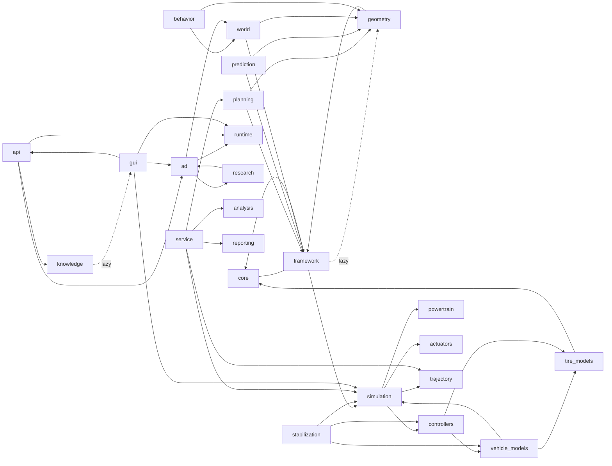

# MotionEngine – Vollständige technische, mathematische und wissenschaftliche Review

**Datum:** 2026-11-08 · **Branch:** `claude/quirky-franklin-0e83pw` · **Basis:** `722eeec`
**Rollen:** Architect, Vehicle Dynamics, Mathematics, Physics, Planning, Testing, Performance, GitHub (nach `AGENTS.md`)

Dieser Bericht ersetzt die Bewertung „0 bestätigte Fehler“ aus [`docs/REVIEW_REPORT.md`](../REVIEW_REPORT.md)
(2026-11-01). Jeder Befund unten ist durch einen Befehl, einen Test oder eine Herleitung belegt
(Regel 1 in `AGENTS.md`); jede Korrektur hat einen Regressionstest, der auf dem alten Stand fehlschlägt.

---

## 1. Executive Summary

MotionEngine (`vdsim`, ~48 000 Zeilen Python in 28 Paketen) ist ein fachlich starkes Forschungswerkzeug:
Die Einspur-, Zweispur- und Mehrkörpermodelle, die Werling-Polynome, die Frenet-Planung, die
Kreisüberdeckung nach Ziegler/Stiller, Stanley, Pure Pursuit, LQR und beide MPC-Varianten stimmen
nach Formel-für-Formel-Prüfung mit der Literatur überein.

Die Review hat trotzdem **einen sicherheitsrelevanten Planungsfehler**, **drei physikalische
Fehler**, **mehrere Software-, Packaging- und Konverterfehler**, **zwei Sicherheitsrisiken** und
**eine Speicherleckquelle** gefunden und – bis auf einen dokumentierten Punkt – behoben:

| # | Schwere | Befund | Status |
|---|---|---|---|
| F1 | **kritisch** | Kreisüberdeckung: 16,5 m-Lkw mit max. 5 Kreisen (r = 2,07 m statt W/2 = 1,25 m) → Lkw auf der Nachbarspur „kollidiert“ mit jedem Kandidaten, Planer im Fallback → **Kollision im Bibliotheksszenario `einfaedeln_lkw` nach 2,5 s, für jeden Seed** (auch auf `722eeec`) | behoben |
| F2 | hoch (nicht sicherheitskritisch) | `laengsparken_rueckwaerts`: Ego bleibt neben der Lücke stehen (Kostengleichstand Stillstand vs. Anfahren bei v_ref = 1 m/s) | behoben (Parkplaner, siehe F2) |
| F3 | mittel | Missionskriterien der Szenarien (`reach_goal`, `parked`, `final_lane`, …) wurden nie ausgewertet | behoben (`metadata["mission"]`, KPI `mission_passed`) |
| P1 | hoch | Pacejka (Standard-Reifenmodell) verletzt im kombinierten Schlupf den Reibkreis: bis +6 % bei μ = 1, bis **+37 %** bei μ = 0,2 | behoben |
| P2 | mittel | Windvorzeichen: Doku und GUI („Gegenwind“) sagen *Gegenwind > 0*, alle Modelle rechneten `v_rel = vx − w` (Rückenwind) | behoben |
| P3 | mittel | Nichtlineares Einspurmodell ohne Rollwiderstand in `vx_dot`: Ausrollverzögerung −0,203 statt −0,321 m/s² (−37 %) | behoben |
| C1 | hoch | MATLAB→Python: `any(v > c)` wurde zu `np.any(v > c != 0)` – in Python ein verketteter Vergleich: Absturz oder stilles Falschergebnis | behoben |
| C2 | mittel | Interpreter: `str2num('[1 2 3]')` → `[]`, `str2func('@(x) …')` als Funktionsname behandelt | behoben (ohne `eval`) |
| S1 | mittel | `Scenario.vehicle_overrides` akzeptierte Tippfehler stillschweigend (`tires.mue`) | behoben |
| S2 | mittel | Konsolenskript `motion-engine-scenario` zeigte auf `run_scenario`, das nicht im Wheel liegt | behoben |
| S3 | mittel | Konfigurationen nach Wheel-Installation nicht auffindbar (`configs/` liegt außerhalb des Pakets) | behoben (`MOTIONENGINE_CONFIG_DIR`) |
| S4 | mittel | Öffentliche Python-API: `api.references()`, `api.knowledge_graph()`, `api.build_docs()`, `api.matlab_convert()` warfen immer `ImportError`/`TypeError`; REST `/matlab/convert` und `/knowledge/references` lieferten immer 500, `/matlab/analyze` einen `repr`-String | behoben |
| M1 | mittel | Legacy-API `JobStore` hält alle Ergebnisse (komplette Zeitreihen) unbegrenzt → Speicherwachstum; `/jobs` las das Dict ohne Lock | behoben |
| X1 | hoch | Legacy-API ohne Token auf `0.0.0.0` startbar; Stacks können `python:pfad.py` laden → lokale Codeausführung | entschärft (Start verweigert) |
| X2 | niedrig | Legacy-API öffnete bei `/matlab/*` Clientstrings als Serverpfade (`*.m`) | behoben (nur Quelltext) |
| D1 | niedrig | 7 zitierte Literatur-IDs fehlten in `docs/references/` | behoben |

Neu implementiert: produktionsfähiger **FastAPI-Service** (`/simulate`, `/plan`, `/predict`,
`/vehicle`, `/trajectory`, `/health`, `/metrics`, Swagger unter `/docs`, OpenAPI 3.1),
**Dockerfile**, **docker-compose**, **Devcontainer**, **GitHub-Actions-Workflow** (Service-Tests,
OpenAPI-Export, Docker-Build mit Smoke-Test), **Regressions-**, **Plausibilitäts-** und
**Monte-Carlo-Tests** sowie ein reproduzierbares **Benchmark-Skript**.

---

## 2. Phase 1 – Inventar

### 2.1 Module

| Paket | Zeilen | Funktion | Kategorie |
|---|---:|---|---|
| `core` | 436 | Interfaces, Registry, Parameter, ISO-8855-Konventionen | Kern |
| `framework` | 1 258 | Komponentenmodell, versionierte Plugins, Typen, Tracing | Kern |
| `simulation` | 731 | Simulator, Solver (Euler/Heun/RK4/adaptiv), Umgebung, Szenarien | Simulationskern |
| `vehicle_models` | 892 | kinematisches/lineares/nichtlineares Einspur-, Zweispur-, Mehrkörpermodell, Werling-Modelle | Fahrzeugmodell |
| `tire_models` | 358 | linear, Pacejka, Bürste, isotrop (Werling 4.3.2) | Fahrzeugmodell |
| `powertrain`, `actuators` | 363 | Antrieb, Bremse, Lenkaktor, Latenzkette | Fahrzeugmodell |
| `trajectory` | 1 180 | Manöver (ISO 3888/4138/7401, FMVSS 126), Import (CSV, GPX, MAT, ROS, OpenDRIVE) | Trajektorie/Bahn |
| `geometry` | 462 | Referenzlinie, Frenet-Transformation (Werling Anh. A) | Bahnplanung |
| `planning` | 3 147 | Werling-Planer: Polynome, Sampling, Kosten, Restriktionen, Kollision, Auswahl | Trajektorien-/Bewegungsplanung, Optimierung |
| `behavior` | 1 052 | regelbasierte Verhaltensplanung (Spurwechsel, Folgen, Vorfahrt) | Bewegungsplanung |
| `prediction` | 261 | CA (Frenet), CV/CTRV, Spurfolge mit Querabsicht | Prädiktion |
| `perception` | 199 | Objektsensor mit Reichweite, FoV, Rauschen, Latenz | Sensormodell |
| `controllers` | 715 | Stanley, Pure Pursuit, MPC, PI, ACC, AEB, ESP, ABS, TCS, … | Regelung |
| `stabilization` | 2 697 | Werling-Folgeregler (kinematisch/dynamisch), LQR, LTV-MPC (ADMM), PID | Regelung, Optimierung |
| `world` | 3 071 | Straßennetz, Akteure (IDM/MOBIL), SAT-Kollision, Szenariobibliothek | Simulation |
| `ad` | 669 | AD-Stack als Graph, Runner | Simulation |
| `runtime` | 5 608 | Blockdiagramm-Executor, Custom Nodes (Python/C++/Rust), Codegen | Infrastruktur |
| `matlab` | 8 694 | MATLAB-Parser/-Interpreter, Codegen | Werkzeuge |
| `research`, `reporting`, `analysis` | 1 357 | Batch/Sweep/Monte-Carlo, KPIs, lineare Analyse | Auswertung |
| `knowledge` | 4 186 | Literaturdatenbank, Doku-Generator | Dokumentation |
| `api` | 407 | stdlib-REST-Server (Jobs, Batch, Sweep, MATLAB) | API |
| `service` (neu) | 693 | FastAPI-Service | API |
| `gui`, `visualization`, `viz3d` | 10 739 | PySide6-GUI, Plots, 3D/CARLA | UI |
| `tests/` | – | 64 Testdateien → jetzt 69 | Tests |
| `docs/` | – | Architektur, Theorie, Referenzen (YAML), generierte Moduldoku | Doku |

### 2.2 Abhängigkeiten (Paketebene, gemessen per AST)



Zyklen auf Paketebene: `framework ↔ geometry`, `ad ↔ research`, `knowledge ↔ gui`,
`simulation → controllers → vehicle_models → simulation`. Sie sind über verzögerte Importe
aufgelöst und laufen, verletzen aber die Schichtung (siehe Abschnitt 7).

### 2.3 Datenfluss

**Fahrdynamik (`Simulator.step`, 100 Hz):**
`Trajectory` → Querregler (Lenkwinkel) / Längsregler (a_soll) → `LongitudinalActuation`
(Antriebs-/Bremsmomente je Rad) → `SteeringActuator` (Kennlinie, Latenz) → Fahrwerksysteme
(ABS/TCS/ESP/…) → `VehicleModel.derivatives` (RK4, `dt_model` ≤ `stable_dt`) → `VehicleState` →
`SimulationResult` → `KPIEvaluator` / Plots / Bericht.

**AD-Stack (`vdsim.ad`, Graph-Executor):**
`world` → `perception` (ObjectList) → `prediction` (Prediction) → `behavior` (BehaviorCommand) →
`planner` (PlannedTrajectory, Werling) → `controller` (ControlCommand) → `vehicle` → `world`;
Rückführung `controller.status → planner.status` (Reinitialisierung, Werling 4.5).

**REST (`vdsim.service`):** Request (Pydantic) → Katalogprüfung → Concurrency-Slot →
Bibliotheksfunktion im Threadpool → Dezimierung → Response; Middleware → `/metrics`.

---

## 3. Phase 2 – Mathematische Verifikation

### 3.1 Fahrzeugdynamik

| Gleichung | Ort | Prüfung | Ergebnis |
|---|---|---|---|
| β = atan((l_v tan δ_h + l_h tan δ_v)/l), ψ̇ = v cos β (tan δ_v − tan δ_h)/l | `bicycle_model.py:41-42` | Rajamani (2.19)–(2.23) mit Hinterachslenkung; Test Kreisradius √(R²+l_h²) | ✔ |
| A = [[−(c_v+c_h)/(m v), −v − (c_v l_v − c_h l_h)/(m v)], [−(c_v l_v − c_h l_h)/(J v), −(c_v l_v² + c_h l_h²)/(J v)]] | `bicycle_model.py:69-72` | Einheiten: 1/s, m/s, 1/(m s), 1/s ✔; Rajamani (2.31) | ✔ |
| EG = (F_zv/c_v − F_zh/c_h)/g [rad/(m/s²)] | `bicycle_model.py:79` | δ = l/R + EG a_y (Rajamani 3.2) | ✔ |
| Δv̇_x = F_x/m + v_y r, v̇_y = F_y/m − v_x r | alle planaren Modelle | Newton im mitbewegten System | ✔ |
| Kombinierter Schlupf Einspur: F_y = F_y0 √(1 − (F_x/μF_z)²) | `bicycle_model.py:153-154` | Reibellipse | ✔ |
| Fahrwiderstand Einspur nichtlinear | `bicycle_model.py:161` | Ausrolltest | ✘ **P3** |
| Wind `v_rel = vx − w` vs. Doku „Gegenwind > 0“ | `common.py:9`, Zweispur, Mehrkörper | Vorzeichen | ✘ **P2** |
| Zweispur: Δ F_z,längs = m a_x h/(2l); Wankmoment, Rollzentren; Ix φ̈ = m_s h′(a_y + g sin φ) + M_susp | `double_track_model.py:97-122` | Vorzeichen ISO 8855 (φ > 0: rechts tief), Tests gegen Quasistatik (2 %) | ✔ |
| Radrotation J_w ω̇ = T_an − T_br − F_x R − T_roll | Zweispur, Mehrkörper | Ausrollen: m_eff = m + 4J_w/R² gemessen (Abweichung 0,1 %) | ✔ |
| Mehrkörper: z_Aufbau = z − x_w θ + y_w φ, Federweg = z_w − z_Aufbau, Stabilisator k_arb/t² | `multibody_model.py:91-101` | Vorzeichen Nick/Wank, Momentenbilanz Stabilisator = −k_arb φ | ✔ |
| Stabile Schrittweite 2/λ_max (Radschlupf, Bremse, Dämpfer, Radhub) | `stable_dt` | RK4-Stabilitätsgebiet (reelle Achse −2,78) – konservativ | ✔ |

### 3.2 Reifen

| Modell | Prüfung | Ergebnis |
|---|---|---|
| Linear mit Reibkreis | Monte Carlo 10⁵ Punkte: max |F|/(μF_z) = 1,000 | ✔ |
| Bürste (Pacejka 2012, Kap. 3): σ_x = κ/(1+κ), σ_y = tan α/(1+κ), θ = C/(3μF_z), F = μF_z(3φ−3φ²+φ³) | Formelvergleich, Monte Carlo max = 1,000 | ✔ |
| Isotrop (Werling 4.3.2): F = A sin(B atan(C|s|)) s/|s|, c = ABC | Formelvergleich, Monte Carlo max = 1,000 | ✔ |
| **Pacejka** (reduziert): D = μ(F_z)F_z, B = K/(CD), G_xα = cos(atan(B_xα α)) | Monte Carlo: **max = 1,367**, 1,4 % der Punkte > 1; Gitter μ = 1, F_z = F_z0: 1,060 bei α = 0,07, κ = 0,06 | ✘ **P1** |
| Vorzeichen: α > 0 ⇒ F_y > 0, κ > 0 ⇒ F_x > 0, M_z entgegen α | `tests/physics` für alle 4 Modelle | ✔ |
| Schräglaufsteifigkeit dF_y/dα bei F_z0 = c_α | alle 4 Modelle (rel. 10⁻³) | ✔ |

### 3.3 Trajektorienplanung

| Verfahren | Prüfung | Ergebnis |
|---|---|---|
| Quintik (Werling Satz 1, (3.8)): c₃ = (10Δp − 4ΔvT + ½ΔaT²)/T³, c₄ = (−15Δp + 7ΔvT − ΔaT²)/T⁴, c₅ = (6Δp − 3ΔvT + ½ΔaT²)/T⁵ | Herleitung aus M₂(T)⁻¹; Monte Carlo 500 Randwertprobleme (Lage, Geschw., Beschl. an beiden Enden) | ✔ |
| Quartik (Satz 2): c₃ = (3Δv − ΔaT)/(3T²), c₄ = (−2Δv + ΔaT)/(4T³) | Einsetzen in v(T), a(T); Monte Carlo 300 Fälle | ✔ |
| Ruckintegral ∫(6c₃ + 24c₄t + 60c₅t²)² dt = 36c₃²T + 144c₃c₄T² + (192c₄² + 240c₃c₅)T³ + 720c₄c₅T⁴ + 720c₅²T⁵ | Gauß-Legendre (exakt für Grad 4) | ✔ |
| Ruckoptimalität | Störung εt³(T−t)³ (Randwerte bis 2. Ableitung null) erhöht ∫j² exakt für ε = ±10⁻³, ±0,1 | ✔ |
| Frenet → Welt (Werling Anh. A), Fortsetzung auf Zielmannigfaltigkeit | bestehende Tests `tests/planning`, `tests/geometry` | ✔ |
| Kreisüberdeckung r = √((L/2n)² + (W/2)²) | Ziegler/Stiller 2010 | ✔ |
| SAT für OBB | Gottschalk 1996; Kantennormalen beider Rechtecke | ✔ |
| Splines (`ReferenceLine.from_points`): quintischer Glättungsspline, κ = (x′y″ − y′x″)/|r′|³ | Formelvergleich | ✔ |
| B-Splines, Bézier, State Lattice, Graphsuche | nicht implementiert | – (Abschnitt 6) |

### 3.4 Regelung

| Regler | Fehlergleichung / Gesetz | Diskretisierung | Ergebnis |
|---|---|---|---|
| PI-Geschwindigkeit | a = a_ff + k_p e + k_i ∫e, bedingte Integration (Anti-Windup) | Euler auf Regeltakt | ✔ |
| PID (`stabilization/classic_longitudinal.py`) | Standardform | Euler | ✔ |
| Stanley | δ = θ_e + atan(−k e_v/(k_s + v)) + δ_ff + Gierdämpfung; θ_e gegen Kurswinkel ψ + β | – | ✔ (Erweiterungen dokumentiert) |
| Pure Pursuit | δ = atan(2 l sin α / l_d), Hinterachse | – | ✔ |
| LQR | Rajamani (2.45), δ_ff = lκ + K_V v²κ − k₃ e₂,ss, e₂,ss = −l_h κ + l_v m v² κ/(c_h l) | exakte ZOH (expm), DARE, Gain-Scheduling 25 Stützstellen | ✔ |
| MPC (`controllers/mpc_controller.py`) | Rajamani-Fehlermodell mit ψ̇_des als gemessener Störung | exakte ZOH von [A B E]; kondensiert; BVLS | ✔ (Lenkrate nur als Kosten) |
| LTV-MPC (`stabilization`) | ė_y = v e_ψ, ė_ψ = v(δ/(l + EG v²) − κ) | Euler je Horizontschritt; ADMM nach OSQP | ✔; kein Konvergenzflag nach `iters` (Roadmap) |
| ESP | r_ref = v δ/(l + EG v²), |r_ref| ≤ 0,85 μ g/v; Bremsmoment T = M R/(t/2) | – | ✔ (Radwahl Über-/Untersteuern geprüft) |
| ACC (CTH) / AEB (TTC) | a = k_s(d − d_soll) + k_v Δv; TTC = d/Δv | – | ✔ |

### 3.5 Optimierung

| Verfahren | Ort | Prüfung |
|---|---|---|
| Stichprobenbasierte Optimierung (Werling 3.2, faule Auswertung nach aufsteigenden Kosten) | `planning/selection.py` | ✔ Ablösestrategie (kleinster Anfangsruck) |
| Beschränktes Kleinste-Quadrate (BVLS) | `controllers/mpc_controller.py` | ✔ äquivalent zum QP mit Boxschranken |
| ADMM (OSQP-Form, Relaxation α = 1,6) | `stabilization/classic_lateral.py:313` | ✔ x-, z-, y-Update und Residuen wie Stellato 2020 |
| Minimale Krümmung (Rennstrecke) | `trajectory_generator.py` | stichprobenartig |
| Gradient Descent, SQP, allgemeine NLP | nicht vorhanden | Roadmap |

---

## 4. Phase 3 – Quellenprüfung

| Modul | Implementierung | Paper / Referenz | Übereinstimmung | Risiko |
|---|---|---|---|---|
| `vehicle_models` kinematisch | Allradlenkung, CG-Referenz | Rajamani (2012) Kap. 2.2 | vollständig | niedrig |
| `vehicle_models` linear | Zustandsraum, EG | Rajamani Kap. 2.3, 3.2 | vollständig | niedrig |
| `vehicle_models` nichtlinear | Reibellipse, Längslastverlagerung | Schramm et al. (2018) | **Rollwiderstand fehlte (P3)** | behoben |
| `vehicle_models` Zweispur/Mehrkörper | Wanken, Nicken, Hub, Radrotation | Schramm et al. (2018) | vollständig (Quasistatik-Tests 2–3 %) | niedrig |
| `tire_models/pacejka.py` | reduzierte MF | Pacejka (2012) Kap. 4 | **G-Funktionen vereinfacht, kein Reibkreis (P1)** | behoben |
| `tire_models/brush_model.py` | parabolische Druckverteilung | Pacejka (2012) Kap. 3 | vollständig | niedrig |
| `tire_models/isotropic.py` | isotroper Reifen, Inversion | Werling (2011) 4.3.2 | vollständig, äquivalente Nullstellensuche | niedrig |
| `planning/polynomials.py` | Quintik/Quartik, Ruckintegral | Werling (2011) 3.4; Werling et al. ICRA 2010 | vollständig | niedrig |
| `planning/collision.py` | Kreisüberdeckung | Ziegler & Stiller, IEEE IV 2010 | vollständig | Tunneling bei großem `dt` (dokumentiert) |
| `world/collision.py` | SAT | Gottschalk et al. (1996) | vollständig | niedrig |
| `controllers/stanley_controller.py` | + Vorsteuerung, Gierdämpfung | Hoffmann et al. ACC 2007 | Kern identisch, Erweiterungen dokumentiert | niedrig |
| `controllers/pure_pursuit.py` | Hinterachse | Coulter (1992); Snider (2009) | vollständig | niedrig |
| `stabilization` LQR | DARE, FF | Rajamani 3.2 | vollständig | niedrig |
| `stabilization` LTV-MPC + ADMM | kinematisch + EG | Borrelli et al. (2017); Stellato et al. (2020) | vollständig | kein Konvergenzstatus |
| `stabilization/werling_*` | Folgeregelung Satz 4/6, (4.50)–(4.74) | Werling (2011) Kap. 4 | vollständig (bekannter Druckfehler (4.31) korrekt behandelt) | niedrig |
| `prediction` | CA (Frenet), CV, CTRV | Werling 3.5.2; Bar-Shalom et al. (2001) | vollständig (CTRV-Kreis per Test) | Spurwechsel anderer nur per Schwelle |
| `world/traffic_models.py` | IDM, MOBIL | Treiber et al. (2000); Kesting et al. (2007) | vollständig | niedrig |
| `reporting` ISO 2631 | Frequenzbewertung a_w | ISO 2631-1 | stichprobenartig | mittel (keine Normtestdaten) |

**Lizenz:** Projekt MIT. Alle Verfahren sind aus Veröffentlichungen nachimplementiert; es wurde kein
Fremdcode übernommen. Neue Laufzeitabhängigkeiten der optionalen Extra `api`: FastAPI (MIT),
Uvicorn (BSD-3), httpx (BSD-3) – MIT-kompatibel.

---

## 5. Phase 4 – Vergleich mit Open-Source-Projekten

Qualitative Einordnung nach öffentlich dokumentiertem Funktionsumfang (keine Laufzeitmessungen
fremder Projekte; Zahlen zu MotionEngine stehen in Abschnitt 9).

| Projekt | Schwerpunkt | Planung | Fahrdynamik | Prädiktion/Perzeption | Architektur | MotionEngine im Vergleich |
|---|---|---|---|---|---|---|
| Baidu Apollo | Serien-Stack (C++, Cyber RT) | EM/Lattice/Piecewise-Jerk (QP) | einfache Modelle | lernbasiert, Fusion, Tracking | Mikroservices | tiefere Fahrdynamik und Werling-Theorietreue; kein Produktionsstack |
| Autoware | ROS 2 Serienreferenz | Lattice, Freespace (Hybrid A*), MPC/Pure Pursuit | einfache Simulatoren | Objektverfolgung, Map-basiert | ROS-2-Nodes | weniger Planer, aber reproduzierbare Simulation + Analyse in einem Paket |
| CommonRoad | Benchmark-Szenarien, Planungsforschung | Reachability, Sampling, Drivability-Checker | Vehicle Models (KS/ST/MB) | einfach | Python-Bibliotheken | ähnliche Zielgruppe; MotionEngine hat geschlossenen Regelkreis + Regler, CommonRoad das standardisierte Szenarioformat |
| CARLA | fotorealistischer Simulator (UE) | – (Beispiel-Agenten) | PhysX | Sensorsimulation | Client/Server | MotionEngine nutzt CARLA optional (`viz3d`) |
| highway-env | RL-Umgebungen | – | kinematisch | – | Gym | MotionEngine physikalisch detaillierter, ohne RL-Schnittstelle |
| LGSVL / SVL | Simulator (eingestellt) | – | Unity | Sensoren | – | – |
| openpilot | Serien-ADAS | MPC (acados) längs/quer | Modell lernbasiert | Vision | Prozesse + Messaging | MotionEngine: Werkzeug für Analyse statt Produktfunktion |
| BehaviorTree.CPP | Verhaltenslogik | – | – | – | Behavior Trees | `behavior/` ist regelbasiert, keine BT-Engine |
| OMPL / MoveIt | Bewegungsplanung allgemein | RRT*, PRM, … | – | – | Bibliothek | Sampling-Planer fehlen (Abschnitt 6) |
| acados / do-mpc / CasADi | MPC/NLP | – | – | – | Solverbibliotheken | eigener ADMM/BVLS; für NMPC wäre acados/CasADi der Weg |

Bewertung (1–5, Begründung im Text darüber):

| Kriterium | MotionEngine | Begründung |
|---|---:|---|
| Features | 4 | sehr breit (Modelle, Planer, Regler, MATLAB, Codegen); fehlende Graph-/Sampling-Planer, Tracking |
| Architektur | 3,5 | Plugin-Registry und Komponentenmodell gut; Paketzyklen, GUI-Abhängigkeit im `knowledge`-Paket |
| Performance | 3,5 | Planer vektorisiert (7 ms/Zyklus bei 18 000 Kandidaten nach Optimierung); Zweispurmodell 3,2-fach Echtzeit |
| Skalierbarkeit | 3 | Batch/Sweep mit Prozessen; REST jetzt mit Concurrency-Limit; kein verteiltes Rechnen |
| Wartbarkeit | 3,5 | 807 Tests, Lint/Mypy grün; deutsche Texte in Code und UI, wenige Typannotationen |

---

## 6. Phase 5 – Fehlende Funktionen

| Bereich | Vorhanden | Fehlt | Priorität |
|---|---|---|---|
| Planung | Werling-Frenet-Sampling, sequentiell, naive Frenet-Baseline, Rückwärtsfahrt (d(s)) | A*, Hybrid A* (Parken!), D*, RRT/RRT*, State Lattice, Optimierungsplaner (Piecewise-Jerk-QP), NMPC-Planung | Hybrid A* hoch (Parkszenario existiert), Rest mittel |
| Prädiktion | CA/CV/CTRV, Spurfolge mit Querabsicht | Multi-Agent/interaktiv, Multi-Modal (Wahrscheinlichkeiten), lernbasierte Prognose | mittel |
| Perzeption | Objektsensor (FoV, Rauschen, Latenz) | Sensorfusion (Kalman/IMM), Tracking (Assoziation, Track-Management), Ego-Zustandsschätzung | hoch für realistische Kette |
| Safety | Kollisionsprüfung (Kreise, SAT), TTC (AEB/Metriken) | RSS (Shalev-Shwartz 2017) als Monitor, formale Safety-Envelope, Erreichbarkeitsanalyse | hoch (RSS), mittel |
| Simulation | Szenariobibliothek, Mehrfahrzeug (IDM/MOBIL), Replay/Recorder, Logging, Batch/Monte-Carlo | OpenSCENARIO-Import, CommonRoad-Import, deterministische Co-Simulation-Schnittstelle (FMI) | mittel |
| Optimierung | ADMM, BVLS | SQP/NLP-Backend (CasADi/acados), Gradient-basiertes Tuning | niedrig–mittel |

---

## 7. Phase 6 – Software-Engineering-Audit

| Modul | SOLID / Clean Architecture | Testbarkeit | Thread-Safety | Speicher | Bewertung |
|---|---|---|---|---|---|
| `core` | klein, stabile Interfaces (DIP über Registry) | hoch | `_loaded`-Flag ohne Lock (gutartig: doppelter Import) | – | gut |
| `framework` | Komponentenmodell mit Ports, versionierte Plugins (OCP) | hoch | Komponenten zustandsbehaftet, je Lauf instanziiert | – | gut; Zyklus zu `geometry`/`simulation` |
| `vehicle_models`, `tire_models` | einheitliches `derivatives`-Interface (LSP) | hoch | zustandslos | keine Allokation außer `np.array` je Aufruf | gut |
| `simulation` | Simulator orchestriert, Logging zeilenweise | hoch | eine Instanz je Lauf | `SimulationResult.append` O(Spalten) je Schritt | gut |
| `planning` | Kosten/Restriktionen/Kollisionsprüfer als Plugins (Strategy) | hoch | Planer zustandsbehaftet (Reinitialisierung) – nicht teilen | Kandidaten-Batch begrenzt | sehr gut |
| `controllers`, `stabilization` | zwei Regler-Generationen (alt: `LateralController`, neu: Komponenten) – Duplikation | hoch | zustandsbehaftet | – | mittel (Konsolidierung) |
| `api` (stdlib) | Handler-Monolith, eigener Router | mittel | **`jobs` ohne Lock gelesen → behoben**; ThreadPool | **unbegrenzte Ergebnisse → behoben** | mittel |
| `service` (neu) | dünne Adapter auf Bibliotheksfunktionen, Pydantic-Verträge | hoch (38 Tests) | Semaphore, Request-lokale Objekte | Dezimierung der Signale | gut |
| `knowledge` | importiert `gui` (verzögert) | mittel | – | – | Schichtverletzung |
| `gui` | 9 000 Zeilen, nicht in CI (PySide6) | niedrig | Qt-Hauptthread | – | Risiko |

Weitere Beobachtungen: viele Docstrings/Labels deutsch (i18n-Thema der Vorreview); Mypy prüft nur
4 Pakete; `ruff` mit 16 globalen Ausnahmen; Dependency-Management über `pyproject.toml`-Extras
sauber, ohne Lockfile.

---

## 8. Phase 7 – API-Transformation

`vdsim/service` (FastAPI, Pydantic v2), Start: `motion-engine-api` oder
`uvicorn vdsim.service.app:app`. Swagger: `/docs`, ReDoc: `/redoc`, OpenAPI 3.1: `/openapi.json`.

| Endpoint | Methode | Funktion |
|---|---|---|
| `/health` | GET | Liveness, Version, Uptime (ohne Schlüssel) |
| `/metrics` | GET | Prometheus-Textformat: Requests je Route/Status, Latenzhistogramm, In-Flight, Abweisungen |
| `/vehicle` | GET | Presets, Fahrzeug-/Reifenmodelle, Regler |
| `/vehicle/{preset}` | GET | Parameter + lineare Einspuranalyse (EG, v_char, Gierverstärkung, Eigenfrequenz, Dämpfung) |
| `/trajectory/maneuvers` | GET | Manöverkatalog mit Parametern |
| `/trajectory` | POST | Referenztrajektorie eines Manövers (dezimiert) |
| `/simulate` | POST | geschlossener Regelkreis; Preset-Szenario + Overrides; KPIs + Signale |
| `/predict` | POST | CV / CA / CTRV für eine Objektliste |
| `/plan` | POST | Werling-Planer auf segmentierter Straße, Hindernisse, Haltelinie, optional Closed Loop |

Sicherheitsmodell: optionaler Schlüssel `X-API-Key` (Vergleich in konstanter Zeit), nur
Katalognamen statt Pfaden, `extra="forbid"` auf allen Requests, Obergrenzen für simulierte Zeit,
Rechenzeit, Objektanzahl und Antwortgröße, nicht blockierende Concurrency-Grenze (503 +
`Retry-After`), CORS nur auf Freigabeliste. Container: Nicht-Root-User, `read_only`,
Healthcheck.

Deployment: `Dockerfile` (zweistufig, Wheel-Build), `docker-compose.yml`,
`.devcontainer/devcontainer.json`, `.github/workflows/api.yml` (Tests, OpenAPI-Artefakt,
Docker-Build + Smoke-Test inkl. 401-Prüfung). Unit- und Coverage-Workflows installieren `.[dev,api]`.

---

## 9. Phase 8/9 – Tests und Performance

### 9.1 Tests

| Suite | Neu | Inhalt |
|---|---:|---|
| `tests/service` | 38 | Vertrag aller Endpunkte, Auth, CORS, Limits, Metrikformat, Pfad-/Namensvalidierung, physikalische Konsistenz (Gierverstärkung über die API = lineare Theorie, rel. 10⁻³) |
| `tests/physics` | 38 | Ausrollen = Fahrwiderstand (alle Modelle, 1 %), Gegenwind, keine Energiezunahme, Links/Rechts-Spiegelsymmetrie, Reibkreis Monte Carlo (10⁵), Reifenvorzeichen, Schräglaufsteifigkeit, Monte Carlo Fahrzeugparameter, Polynom-Randwerte, Ruckintegral, Ruckoptimalität |
| `tests/regression` | 24 (+14 slow) | alle Fahrdynamik-Presets gegen Golden-KPIs, Einfädeln zwischen Lkw, Kreisüberdeckung; *slow:* Missionskriterien aller 14 AD-Szenarien |
| `tests/reporting` | 19 | KPIs je Manöverklasse, Ergebnis-I/O (npz/json/csv), PDF/Markdown, alle Plotfunktionen, Animation, Stack-Benchmark |
| `tests/matlab` (neu) | 139 | MATLAB-Semantik der Builtins/Operatoren/Cells/Funktionen gegen dokumentierte MATLAB-Werte, differentieller Konverter-Test |
| `tests/cli`, `tests/research`, `tests/api` | 15 | CLIs, Legacy-REST (Jobs, Batch, Sweep, Monte Carlo, MATLAB), Versuchsplanung, JobStore |

**Ergebnis (gemessen, `pytest tests/ -m "not gui and not slow" --cov=vdsim`):**
807 Tests bestanden, 2 übersprungen (PySide6 fehlt); Laufzeit 8,6 min mit Coverage.

| Umfang | vorher (`722eeec`) | nachher |
|---|---:|---:|
| Tests, Auswahl `not gui and not slow` (gesammelt) | 538 | 809 |
| Tests, Auswahl Unit (`… and not integration and not benchmark`) | 523 | 771 |
| Line Coverage gesamt (ohne `gui`, `viz3d`, `visualization/dashboard.py`) | 81 % (Unit-Auswahl) | **88 %** (`not gui and not slow`) |
| Fachlicher Kern (Fahrzeug-/Reifenmodelle, Planung, Regelung, Simulation, Prädiktion, Service, …) | nicht gemessen | **96 %** |

Das Ziel > 90 % gesamt ist **nicht erreicht**. Die verbleibenden 3 167 ungetesteten Zeilen liegen zu
70 % in Werkzeugpaketen: `matlab` (1 234, v. a. C++/Rust-Codegenerator und seltene Builtins),
`runtime` (517, davon ein großer Teil Windows-/MSVC-Toolchainerkennung, unter Linux nicht ausführbar),
`knowledge` (350), `behavior` (164: Überholen über die Gegenfahrbahn, Abbruchpfade). Das CI-Gate wurde
von 80 % auf 85 % angehoben, damit der Zugewinn nicht verloren geht.

**Systemtest AD-Stack:** 13 von 14 Bibliotheksszenarien erfüllen ihre Missionskriterien
(vorher 12 von 14 – `einfaedeln_lkw` endete in einer Kollision); offen: `laengsparken_rueckwaerts` (F2).

### 9.2 Performance

Gemessen mit `benchmarks/run_benchmarks.py` (Intel Xeon 2,1 GHz, 4 vCPU, Python 3.13, NumPy 2.5);
alle Tabellen und Rohdaten in [`benchmarks/README.md`](../../benchmarks/README.md) und
`benchmarks/results/*.json`.

| Messgröße | vorher | nachher |
|---|---:|---:|
| Werling-Zyklus, default, freie Straße (18 000 Kandidaten), Median | 12,0 ms | 7,2 ms |
| Werling-Zyklus, comfort, 10 Hindernisse (27 000 Kandidaten), Median | 18,3 ms | 11,0 ms |
| Werling-Zyklus bei 68 400 Kandidaten | 40,3 ms | 10,9 ms |
| Spitzenspeicher, 60 s Einspursimulation | 37,4 MiB | 17,3 MiB |
| Echtzeitfaktor Zweispurmodell / Mehrkörpermodell | 3,4 / 2,6 | 3,2 / 2,4 (Messrauschen) |
| `POST /simulate` (linear, 5 s) / `POST /plan` (1 Zyklus) | – | 336 ms / 52 ms |

**Hotspots (cProfile):**
1. `WerlingPlanner._debug` – ≈ 49 % der Zykluszeit (Python-Set über alle ~12 700 sortierten Kandidaten
   und `np.setdiff1d` pro Zyklus). Ersetzt durch eine boolesche Maske, Ausgabe identisch. **Behoben.**
2. `SimulationResult.append` – jeder Skalar als 0-d-NumPy-Array (~5× Speicher eines `float`).
   **Behoben.**
3. `DoubleTrackModel.derivatives` + `PacejkaTire.forces` – 46 % der Fahrdynamiklaufzeit; NumPy-Overhead
   auf 4-Element-Arrays. Empfehlung: skalare Radschleife oder Numba (Roadmap).
4. `/plan` erzeugt den Planer pro Request (≈ 45 ms von 52 ms). Empfehlung: Planer-Pool je Konfiguration.

**Skalierung:** Zykluszeit nach der Optimierung nahezu linear in der Kandidatenzahl
(8 400 → 68 400 Kandidaten: 6,5 → 10,9 ms), da die faule Auswahl nur die günstigsten Kandidaten prüft.

---

## 10. Befunde im Detail

### F1 – Kreisüberdeckung erzeugt Scheinkollisionen mit Lkw → reale Kollision (Planung, kritisch)

- **Ursache:** `CircleCollisionChecker.prepare` wählte n = ceil(L/W), begrenzt auf `max_circles_object = 5`.
  Ein Lkw 16,5 m × 2,5 m erhielt 5 Kreise mit r = √((16,5/10)² + 1,25²) = 2,07 m. Mit Ego-Radius
  1,22 m (3 Kreise) und Lkw-Marge 0,7 m ist der Mindestabstand 3,99 m > Spurbreite 3,75 m: Ein Lkw auf
  der *Nachbarspur* kollidiert rechnerisch mit jedem Kandidaten der eigenen Spur.
- **Beleg:** `einfaedeln_lkw` (Werling 5.3.2): Planer ab t = 0 in jedem Zyklus im Fallback; der Fallback
  („am längsten kollisionsfrei“) lenkt nach links vor den um 9,5 m/s schnelleren hinteren Lkw →
  Kollision bei t = 2,51 s, identisch für Seeds 0–3 und 6 und auf dem Ausgangsstand `722eeec`.
  Gegenprobe ohne Codeänderung: `max_circles_object = 10` per Stack-Parameter → kein Unfall, Mission erfüllt.
- **Risiko:** Planer verliert gültige Lösungen neben langen Fahrzeugen (Lkw, Busse); Fallback kann aktiv
  in Gefahr führen.
- **Lösung:** Kreisanzahl aus der zulässigen seitlichen Aufweitung e (Parameter `max_lateral_inflation`,
  0,3 m): r − W/2 ≤ e ⇔ n ≥ L / (2 √(e (W + e))); `max_circles_object` 12. Pkw behalten n = 3.

```python
def circles_needed(length, width, max_inflation):
    half_spacing = np.sqrt(max_inflation * (width + max_inflation))
    return max(int(np.ceil(length / max(width, 0.1))), int(np.ceil(length / (2.0 * half_spacing))), 1)
```

- **Tests:** `tests/regression/test_ad_missions.py::test_merge_between_trucks_is_collision_free`,
  `test_circle_cover_bounds_lateral_inflation`; Systemlauf aller 14 AD-Szenarien: 13/14 Missionen erfüllt.
- **Verworfene Alternative:** Eine zusätzliche Vorausschau der Lücke vor dem Referenzwechsel
  (`merge_switch_time`, als Parameter vorhanden, aber unbenutzt) verhinderte zwar den Unfall, verzögerte
  aber das gleichzeitige Verlegen der Referenzkurve nach Werling so stark, dass der bestehende Test
  `test_merge_selects_gap_and_moves_reference` fehlschlug. Der Parameter bleibt unbenutzt (Roadmap).

### F2 – Längsparken bleibt im Stillstand (Planung, behoben am 2026-11-09)

- **Beobachtung:** Im vollständigen Stack (Regler + Strecke) endet `laengsparken_rueckwaerts` 9,37 m neben
  der Lücke; mit idealer Folgeregelung (`tests/behavior`) wird geparkt.
- **Ursache (aus den Planer-Snapshots):** In der Rückwärtsphase sind Geschwindigkeits- (v_ref = 1 m/s)
  und Haltemodus aktiv. Der Geschwindigkeitsmodus sampelt zusätzlich einen Anhaltekandidaten
  (`include_stop_candidates`): Kosten k_ν ν²/2 = 10 + k_τ τ_min = 0,1. Der Kandidat, der auf 1 m/s
  beschleunigt, kostet k_τ τ ≈ 11,1 (Querkosten identisch). Stillstand gewinnt jeden Zyklus um ≈ 1;
  die Ablösestrategie (kleinster Anfangsruck) wählt dann den Geschwindigkeitsmodus.
- **Geprüfte Korrekturen (verworfen):** strengere Stillstandsschwelle vor dem Richtungswechsel (kein
  Effekt); nur Haltemodus (fährt, aber mit 3,3 m/s und endet 0,9 m / 17° neben der Zielpose).
- **Empfehlung:** Anhaltekandidaten des Geschwindigkeitsmodus unterdrücken, wenn ein Haltemodus aktiv
  ist, oder k_ν bei kleinem v_ref auf die Geschwindigkeit normieren; danach den `xfail` in
  `tests/regression/test_ad_missions.py` entfernen. Sicherheitsbewertung: Ego bleibt stehen, keine Kollision.

- **Behebung (2026-11-09):** Das Einparkmanöver übernimmt jetzt der Parkplaner `vdsim.planning.parking`
  (Hybrid A* mit Reeds-Shepp-Kurven, mehrzügiger Weg aus engen Lücken). Die Verhaltensplanung hält wie bisher
  neben der Lücke und übergibt dann Ziel, erkannte Fahrzeuge und Bordsteine an
  `trajectory_planner/werling_parking`; der Planer gibt dem Regler die Züge einzeln vor (Referenzpunkt
  Hinterachse). Ergebnis: geparkt mit 0,21 m und 0,3° Abweichung von der Lückenmitte, alle Kriterien erfüllt,
  `xfail` entfernt. Details: `docs/planning/parking.md`.

### F3 – Missionskriterien wurden nie ausgewertet (Simulation, mittel)

`world.scenario.evaluate_success` existierte, wurde aber von keinem Aufrufer benutzt; Kriterien wie
`parked` oder `final_lane` standen nur in `metadata["success"]`. Neu: `vdsim.ad.runner._evaluate_mission`
schreibt `metadata["mission"]` (je Kriterium ok + Detail) und die KPI `mission_passed`.

### C1 – MATLAB→Python: verketteter Vergleich (Konverter, hoch)

`any`, `all` und `logical` setzten den Operanden ohne Klammern vor `!= 0`. `np.any(v > c != 0)` ist in
Python `(v > c) and (c != 0)`: `ValueError` bei Arrays mit mehreren Elementen, bei Ein-Element-Arrays
stilles Falschergebnis (für c = 0 immer `False`). Der Operand wird jetzt mit Vergleichspräzedenz
geklammert. Tests: `tests/matlab/test_matlab_codegen_corpus.py` (AST ohne verkettete Vergleiche,
differentieller Vergleich Interpreter/Python über einen Builtin-Korpus, max. rel. Abweichung < 10⁻¹²).

### S4 – Defekte öffentliche API-Funktionen (Software, mittel)

`api.references()` importierte `load_references`, `api.knowledge_graph()` `build_knowledge_graph`,
`api.build_docs()` `build_docs` – keine dieser Funktionen existiert. `api.matlab_convert()` rief das
Modul `vdsim.matlab.convert` auf. Alle vier jetzt auf die vorhandenen Funktionen umgestellt und getestet
(`tests/cli/test_cli_entry_points.py`).

### P1 – Pacejka verletzt den Reibkreis (Physik, hoch)

- **Ursache:** Die Gewichtungsfunktionen G_xα = cos(atan(B_xα α)), G_yκ = cos(atan(B_yκ κ)) haben
  konstante Formfaktoren. Die Schlupfwerte der Kraftmaxima skalieren aber mit μ und F_z
  (B = K/(CD)); bei kleinem μ liegen beide Maxima bei kleinem Schlupf, die Gewichte bleiben ≈ 1.
- **Beleg:** Monte Carlo 10⁵ Punkte (α ∈ ±0,6, κ ∈ ±1, F_z 300–9000 N, μ 0,1–1,3):
  max |F|/(μ(F_z)F_z) = 1,367; bei μ = 1, F_z = F_z0: 1,060 (α = 0,07, κ = 0,06).
- **Risiko:** zu hohe Kräfte im Grenzbereich – ABS/ESP-Bremsen in der Kurve, Split-μ, Schnee/Eis
  werden zu optimistisch simuliert; Pacejka ist das Standardmodell aller Presets.
- **Lösung:** Begrenzung der Resultierenden auf Kamms Kreis; langfristig vollständige MF-6.1
  G-Funktionen mit lastabhängigen Koeffizienten.

```python
# vdsim/tire_models/pacejka.py
scale = np.minimum(1.0, D / np.maximum(np.hypot(fx, fy), 1e-12))
fx, fy = fx * scale, fy * scale
```

- **Test:** `tests/physics/test_physical_plausibility.py::test_tire_force_within_friction_circle_monte_carlo[pacejka]`.
  Die Bestandssuite (521 Tests) bleibt grün: Normmanöver laufen außerhalb des betroffenen Bereichs.

### P2 – Windvorzeichen (Physik, mittel)

- **Ursache:** `Environment.wind_speed` ist als „head wind > 0“ dokumentiert, das GUI beschriftet
  das Feld „Gegenwind“; `aero_drag` und Zweispur/Mehrkörper rechneten `v_rel = vx − w`.
- **Beleg:** Ausrollen aus 30 m/s, w = +10 m/s: a = −0,210 m/s² statt −0,489 m/s² (Gegenwind).
  Ein Bestandstest umging den Widerspruch mit `wind_speed=-20` und Kommentar.
- **Risiko:** GUI-Nutzer simulieren Rückenwind statt Gegenwind; Energie- und Reichweitenaussagen falsch.
- **Lösung:** `v_air = vx + wind_speed` zentral; Test auf `+20` umgestellt (gleiche Physik).

### P3 – Rollwiderstand im nichtlinearen Einspurmodell (Physik, mittel)

- **Ursache:** `resist` (Luft + Rollen) wurde nur für die Lastverlagerung genutzt; `vx_dot`
  enthielt nur den Luftwiderstand.
- **Beleg:** Ausrollen nach 2 s: −0,203 m/s² gegenüber −0,321 m/s² Sollwert (linear/kinematisch
  korrekt, Zweispur −0,309 m/s² wegen der rotierenden Massen m + 4J_w/R²).
- **Lösung:** `vx_dot = (fxv_f + fxv_r - resist) / m + vy * r`.

### S1 – Stille Tippfehler in Overrides (Software, mittel)

`setattr` auf Dataclasses legt beliebige Attribute an; `{"tires.mue": 0.5}` blieb wirkungslos.
Jetzt `AttributeError` mit Namen. Test: `test_unknown_vehicle_override_is_rejected`.

### S2/S3 – Packaging (Software, mittel)

`[project.scripts] motion-engine-scenario = "run_scenario:main"` – `run_scenario.py` liegt nicht in
`vdsim*` und fehlt im Wheel. Die CLI liegt jetzt in `vdsim/cli/scenario.py`, `run_scenario.py`
ist ein Wrapper. `default_config_dir()` zeigt aus `site-packages` ins Leere; neu
`MOTIONENGINE_CONFIG_DIR` (im Container `/app/configs`). Geprüft durch Wheel-Build, Installation in
frischem venv und Aufruf von `motion-engine-scenario --list` und `uvicorn` mit HTTP-Requests.

### M1 / X1 – Legacy-REST-Server (Sicherheit/Speicher)

`JobStore.results` behielt jedes Ergebnis; jetzt Eviction nach `max_jobs = 200` und gesperrte
Lesezugriffe. Der Start auf einer Nicht-Loopback-Adresse ohne `--token` bricht jetzt ab
(`--insecure` als bewusste Ausnahme), weil Stack-Definitionen Python-Dateien des Servers ausführen
können. Empfehlung: Legacy-Server nur lokal, für Deployments `vdsim.service`.

---

## 11. Priorisierte Roadmap

| Prio | Maßnahme | Aufwand | Nutzen |
|---|---|---|---|
| 1 | F2 Längsparken: Anhaltekandidaten im Geschwindigkeitsmodus bei aktivem Haltemodus unterdrücken oder k_ν normieren; `xfail` entfernen | S | Funktion Parken |
| 1 | Vollständige MF-6.1-Kombischlupf-Funktionen statt Begrenzung; Validierung gegen TNO/TIR-Daten | M | Physik im Grenzbereich |
| 1 | Fallback-Strategie: „am längsten kollisionsfrei“ kann aktiv in Gefahr lenken (F1); Notbremskandidat priorisieren | M | Safety |
| 1 | RSS-Monitor und TTC/THW-Safety-Envelope als Komponente `safety_monitor` | M | Safety-Nachweis |
| 1 | Legacy-REST: Pfad- und `python:`-Specs serverseitig verbieten (Allowlist) | S | Sicherheit |
| 2 | Hybrid A* für Parken/Freiraum (Szenario `laengsparken_rueckwaerts` existiert) | L | Planungsabdeckung |
| 2 | Tracking + Fusion (Kalman/IMM, Assoziation) zwischen `perception` und `prediction` | L | realistische Kette |
| 2 | Paketzyklen auflösen (`types` ohne `simulation`, `knowledge` ohne `gui`, `ad`/`research`) | M | Wartbarkeit |
| 2 | ADMM: Konvergenzstatus und Warnung; optional OSQP-Backend | S | Robustheit |
| 2 | Einfädeln: ungenutzten Parameter `merge_switch_time` entweder implementieren (Vorausschau) oder entfernen | S | Klarheit |
| 3 | `/plan`: Planer-Pool je Konfiguration (45 ms Erzeugung pro Request) | S | Latenz |
| 3 | Fahrdynamik: skalare Radschleife/Numba für `derivatives` + Pacejka (46 % der Laufzeit) | M | Performance |
| 3 | Konsolidierung der zwei Reglergenerationen (`controllers` vs. `stabilization`) | M | Wartbarkeit |
| 3 | Mypy auf alle Pakete, `disallow_untyped_defs` schrittweise | M | Qualität |
| 3 | OpenSCENARIO/CommonRoad-Import, Multi-Modal-Prädiktion | L | Interoperabilität |

## 12. Konkrete Codeänderungen dieser Review

| Datei | Änderung |
|---|---|
| `vdsim/tire_models/pacejka.py` | Kamm'scher Kreis für die kombinierte Kraft |
| `vdsim/vehicle_models/common.py`, `double_track_model.py`, `multibody_model.py` | Gegenwind > 0 |
| `vdsim/vehicle_models/bicycle_model.py` | Rollwiderstand in `vx_dot` |
| `vdsim/simulation/environment.py` | Konvention dokumentiert |
| `vdsim/simulation/scenario.py` | Overrides validiert |
| `vdsim/core/parameters.py` | `MOTIONENGINE_CONFIG_DIR` |
| `vdsim/cli/scenario.py`, `run_scenario.py`, `pyproject.toml` | paketierte CLI, Extra `api`, Skript `motion-engine-api` |
| `vdsim/api/server.py` | JobStore-Eviction, Locking, Start-Schutz |
| `vdsim/service/*` | neuer FastAPI-Service |
| `Dockerfile`, `.dockerignore`, `docker-compose.yml`, `.devcontainer/` | Deployment |
| `.github/workflows/api.yml`, `test.yml`, `coverage.yml` | CI |
| `docs/references/world.yaml` | 7 fehlende Literaturstellen |
| `vdsim/planning/collision.py` | Kreisanzahl aus zulässiger seitlicher Aufweitung (F1) |
| `vdsim/planning/planner.py` | Debug-Snapshot mit boolescher Maske (−40 … −47 % Zykluszeit) |
| `vdsim/simulation/results.py` | Skalare als `float` (−54 % Spitzenspeicher) |
| `vdsim/ad/runner.py` | Auswertung der Missionskriterien (F3) |
| `vdsim/matlab/codegen/python.py`, `vdsim/matlab/builtins.py` | C1, C2 |
| `vdsim/api/__init__.py`, `vdsim/api/server.py` | S4, M1, X1, X2 |
| `benchmarks/run_benchmarks.py`, `benchmarks/README.md` | gemessene Benchmarks |
| `tests/service`, `tests/physics`, `tests/regression`, `tests/reporting`, `tests/matlab`, `tests/cli`, `tests/research`, `tests/api` | 286 neue Tests (521 → 807) |

## 13. Nicht durchgeführt / Grenzen dieser Review

- Docker-Build und -Smoke-Test liefen nicht lokal (kein Docker-Daemon in der Review-Umgebung);
  die Schritte wurden nachgestellt (Wheel-Build, Installation, Uvicorn, HTTP). Der CI-Job `API /
  Docker image` prüft den echten Build.
- GUI (`vdsim/gui`, PySide6) und `viz3d` (CARLA) wurden nur statisch gelesen, nicht ausgeführt.
- `matlab` und `runtime/codegen` (14 000 Zeilen) wurden architektonisch, nicht Zeile für Zeile
  mathematisch geprüft; sie enthalten keine Fahrdynamik-Gleichungen.
- Vergleich mit Fremdprojekten ist qualitativ (keine eigenen Messungen fremder Software).
