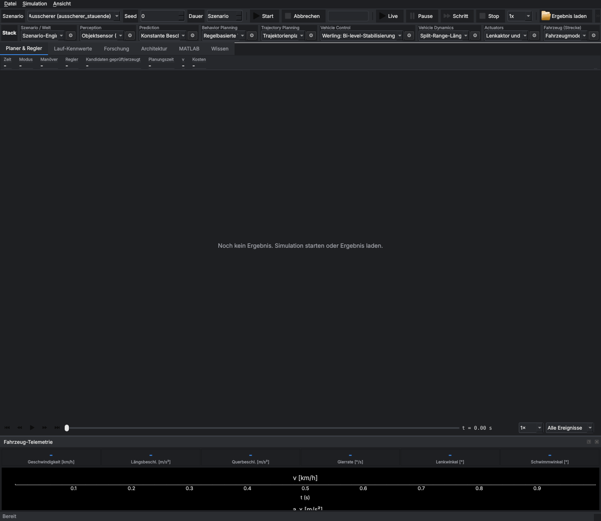
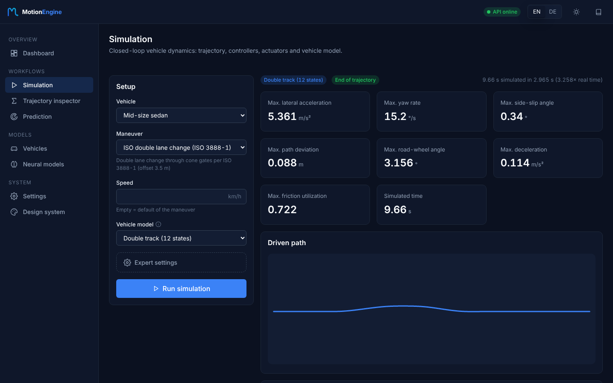
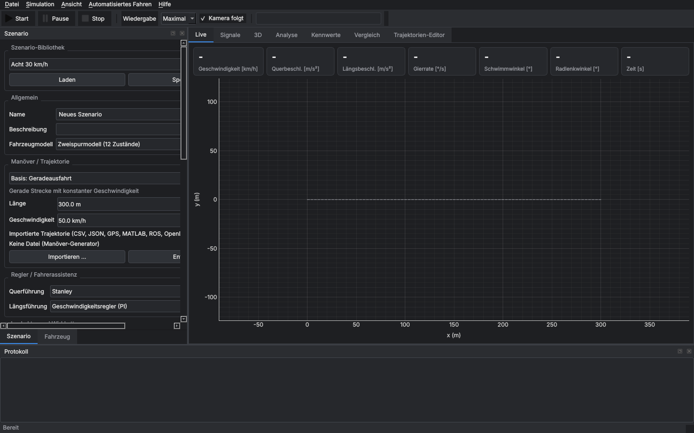
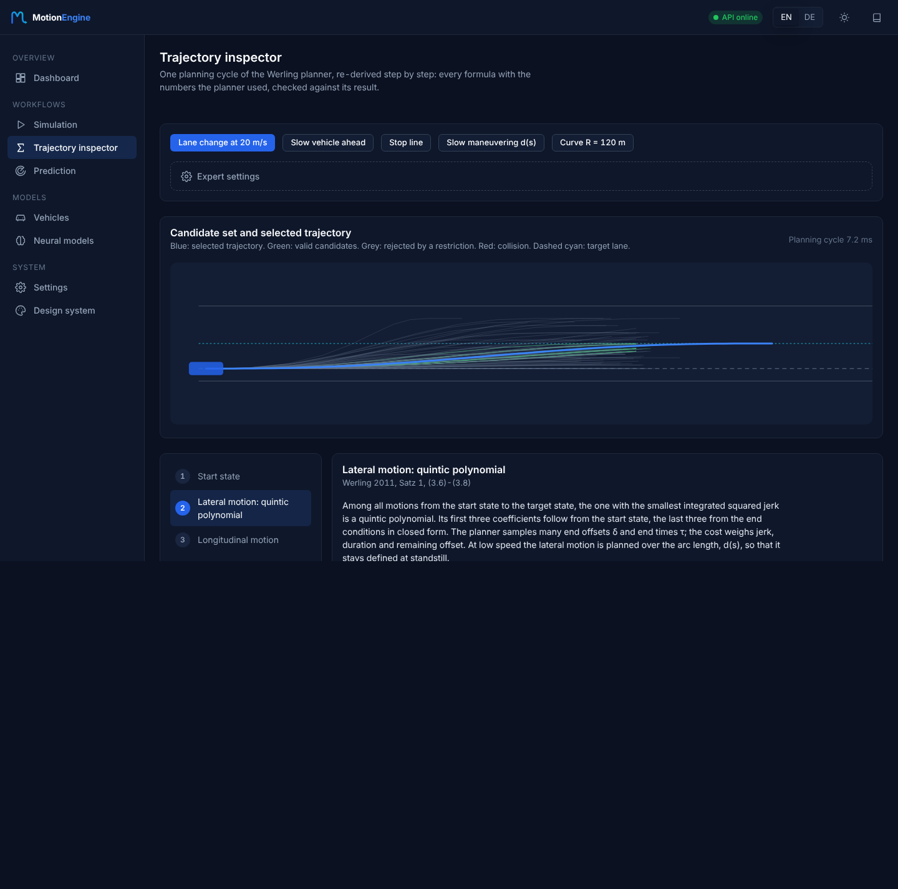

# MotionEngine redesign: web app, trajectory inspector, neural models

Date: 2026-11-08. Scope: a new web front end (`web/`) on the REST service, branding, a design system,
English/German internationalization, a step-by-step derivation of planned trajectories and a module to train
or connect neural vehicle models. The PySide6 desktop GUI (`vdsim/gui`) stays as it is and keeps working.

## 1. Before / after

| Aspect | Before (PySide6 workbench) | After (web app) |
|---|---|---|
| Access | local desktop install with PySide6, Qt and OpenGL libraries | browser; served by the API container (`docker compose up`) or `MOTIONENGINE_WEB_DIR` |
| Startup | 4.6–5.5 s to a visible workbench window (offscreen, median of 3: 5.3 s) | first contentful paint 124–144 ms for the app pages, 440 ms for the landing page (local server, median of 3) |
| Language | German only, strings hardcoded in widgets (24 GUI files with German text) | English (default) and German; every visible string is a translation key, checked by tests |
| Theme | one dark Qt theme | dark and light theme, WCAG AA contrast, system preference detected, no flash on load |
| Branding | text title "vdsim" | logo, app icon, favicons, PWA manifest, GitHub avatar (`docs/brand/`) |
| How a trajectory is computed | only the result: path and signals in the top view and scope | Trajectory inspector: seven steps, each with formula, values used and a chart (see §3) |
| Neural models | none | train an MLP surrogate, connect ONNX or HTTP models, evaluate closed-loop, simulate with it |
| Empty, loading, error states | blank panels, errors in the log | illustration + explanation + action, skeletons, errors that say what failed and what to check |
| Expert parameters | every parameter visible in long trees | defaults run with one click, advanced options in collapsed "Expert settings", tooltips with unit and meaning |
| Mobile | not available | responsive layout down to 375 px, navigation drawer |
| Tests | GUI excluded from coverage | i18n unit tests, Playwright end-to-end run over all pages × 2 languages × 2 themes, mobile check |

Screenshots: `docs/ux/before/` (PySide6) and `docs/ux/after/`:

| Before | After |
|---|---|
|  |  |
|  |  |

More after screenshots: landing page (`landing-en-dark.png`), dashboard (`app-en-dark.png`), German inspector
(`inspector-lateral-de-dark.png`), neural models after a closed-loop comparison (`models-evaluated-en-dark.png`),
vehicles and style guide in the light theme, inspector on a phone (`mobile-inspector-en.png`).

## 2. Summary of improvements

### UI and UX
- New React 19 + TypeScript app with pages Dashboard, Simulate, Trajectory inspector, Neural models, Predict,
  Vehicles, Settings, a landing page ("Modern Motion Planning and Vehicle Simulation Platform") and a live
  style guide at `/app/design`.
- Every workflow runs with defaults; expert parameters sit in `details.expert`. Every number has a unit,
  every parameter a tooltip with its meaning (from the library metadata).
- Onboarding: the dashboard leads through the three main workflows; empty states explain the next step.
- Recent runs are kept per browser so the dashboard shows the last results.
- Accessibility: landmarks, one `h1` per page, focus ring, `aria-live` for results, keyboard tabs,
  `prefers-reduced-motion`; checked in the end-to-end run.

### Trajectory inspector (physics and math for engineers)
`POST /plan/explain` runs one cycle of the Werling planner and returns the derivation. The page shows:
1. **Start state** in Frenet coordinates (s, ṡ, s̈, d, ḋ, d̈) from the vehicle state.
2. **Lateral motion**: the quintic `d(t)` that minimizes the jerk integral, its six coefficients and the boundary
   conditions; the coefficients are re-derived independently and the deviation from the planner is reported
   (≤ 2·10⁻¹⁶ in all tested modes).
3. **Longitudinal motion**: quintic (stopping, following) or quartic (velocity keeping) `s(t)`.
4. **Selection**: cost terms ½k_j J + k_τ τ + ½k_δ δ² with numbers, all candidates drawn, the chosen one highlighted.
5. **Transformation** Frenet → world (A.1–A.6): heading, curvature, speed, acceleration.
6. **Restrictions**: curvature, acceleration, collisions; which ones the candidate passed.
7. **Vehicle physics**: steady-state single-track model, lateral forces `F_yf = m a_y l_r / L`, slip angles
   `α = F/C`, steering `δ = Lκ + EG·a_y`, compared with the tire limits.

Formulas are LaTeX rendered with KaTeX. They contain no natural-language words, so they fit both languages.

### Neural models
- `vdsim.learning`: NumPy MLP (tanh, Xavier, Adam, standardization, early stopping) that learns
  [v̇x, v̇y, ṙ] from [vx, vy, r, δ, Fx] with a physics model as teacher. It needs no extra framework.
- Training runs as a background job; you can follow progress and cancel it.
- Backends: built-in MLP, ONNX file (extra `ml`), HTTP endpoint (only hosts in `MOTIONENGINE_ALLOWED_MODEL_HOSTS`).
- Each model is registered as vehicle model `neural_<id>` and can be used in `/simulate` and on the Simulate page.
- Closed-loop evaluation against the teacher on a maneuver. At default settings: R² ≥ 0.998; double lane change
  max path error 5.5 cm.

### Internationalization
- i18next / react-i18next, namespaces `common`, `app`, `inspector`, `landing`, `domain` in
  `web/src/locales/{en,de}`.
- Detection order: stored choice (`me.lang`) → browser language → English. `<html lang>` follows the language.
- Units stay SI. Numbers use `Intl.NumberFormat`, so German shows a decimal comma.
- The API returns language-neutral codes (`stop_code`, KPI `value_code`/`group_code`) instead of German text.
- `domain.json` is generated from the library labels (`web/scripts/generate_domain_locales.py`); CI fails when
  it drifts.
- `i18n.test.ts` fails on hardcoded JSX text, untranslated `aria-label`/`title`/`alt`, missing keys and
  mismatched interpolation variables.

### Branding and design system
- Three logo options (`docs/brand/logo-option-a/b/c.svg`). Option B was chosen: an "M" that becomes a planned
  trajectory and ends in a vehicle arrow, with a gradient from #2563EB to #06B6D4 on #0F172A.
- Assets: light/dark logos, app icon, SVG and PNG favicons, Apple touch icon, PWA icons and the GitHub avatar
  (500 × 500).
- `docs/design-system.md`: principles, color tokens for both themes, type scale, 4 px spacing grid, motion,
  components, chart rules, writing and i18n rules.

### Product readiness
- The API serves the built app (path-safe, with a traversal test); the Docker image contains it.
- New CI workflow `Web`:
  - typecheck, i18n tests and build with a bundle report;
  - locale drift check;
  - Playwright end-to-end run that uploads screenshots.
- Python: 57 service tests including explain, learning, models API, SSRF rules and static hosting;
  mypy now also covers `vdsim/service` and `vdsim/learning`.

## 3. Performance optimizations

| # | Optimization | Effect (measured) |
|---|---|---|
| 1 | Route-level code splitting: every page is its own chunk (`React.lazy`) | page chunks 0.5–14.6 kB; app shell `index` 81 kB (28 kB gzip) |
| 2 | Vendor chunks (`react`, `i18n`, `uplot`, `katex`) cached separately from app code | an app update does not invalidate the 262 kB React chunk |
| 3 | KaTeX (264 kB JS + fonts) loaded only when a formula is on screen | Simulate, Models, Dashboard never download it |
| 4 | uPlot canvas charts instead of one DOM node per point; loaded on demand (51 kB) | thousands of samples per series without layout cost; data updates via `setData` instead of re-creating the chart |
| 5 | SVG top view with `vector-effect: non-scaling-stroke`; candidate list capped at 120 + the selected one | inspector response stays small, drawing stays sharp at every zoom |
| 6 | Heavy compute on the server (simulation, planning, training) and training in a background thread with job polling | the UI thread only renders; workflow times below include the full computation |
| 7 | Memoized derived data (`useMemo`) and memoized `Chart`, `PathPlot`, `Formula`, `KpiTile` | editing a parameter does not re-render or re-create charts and formulas |
| 8 | Skeletons with the final layout, theme set before first paint (`index.html`) | no layout shift and no theme flash |
| 9 | No web font on the critical path (system font stack); i18n resources bundled, no extra request | first contentful paint 124–144 ms on app pages |
| 10 | Backend (previous round): planning cycle 40–47 % faster, `SimulationResult` memory 37 → 17 MiB | applies to all API calls the app makes |

Measurements (Chromium headless, local server, this container):

| Measurement | Value |
|---|---|
| First contentful paint `/app`, `/app/simulate`, `/app/inspector`, `/app/models` | 128, 124, 144, 132 ms |
| First contentful paint landing page | 440 ms |
| Page load to network idle (includes 500 ms idle window), all pages × 4 language/theme combinations | 541–927 ms |
| Workflow: run double lane change simulation until KPIs shown | 4.35 s |
| Workflow: plan + derivation until the inspector shows step 1 | 0.86 s |
| Workflow: train MLP (4000 samples, 40 epochs) until listed | 2.9 s alone; 11.9 s while the full pytest suite ran in parallel |
| PySide6 workbench startup (before) | 4.6–5.5 s |

## 4. How to run

```bash
cd web && npm ci && npm run build && cd ..
MOTIONENGINE_WEB_DIR=web/dist motion-engine-api --port 8000   # http://localhost:8000/
cd web && npm test && npm run e2e                             # needs the server above
```

## 5. Open points

- The PySide6 GUI is not translated. The web app is now the primary UI.
- Training uses the built-in NumPy MLP. Larger networks can be trained elsewhere and connected as ONNX.
- `laengsparken_rueckwaerts` (review finding F2) is still open and visible in the inspector as a standstill.
